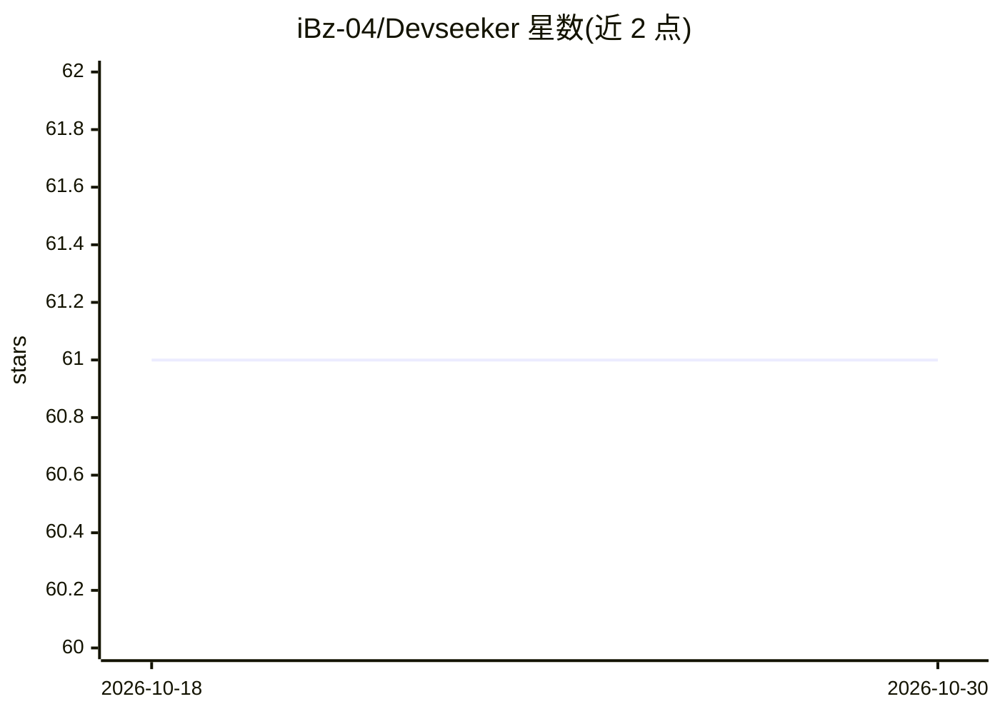

# iBz-04/Devseeker

⭐ 61 · Python · MIT · 推送 2026-04-11 · [GitHub](https://github.com/iBz-04/Devseeker) · [官网](https://pypi.org/project/devseeker) · 个人维护

**从自然语言 prompt 生成并改进代码项目的命令行 coding agent**

受 Claude Code 与 Codex 启发的终端 coding agent：读取 prompt 文件后生成代码项目、创建入口文件并可执行；通过 improve 模式交互式选择文件、以 diff 视图审阅并接受/拒绝改动；支持 standard/improve/clarify/lite/self-heal 五种模式，self-heal 可在代码运行失败时自动修复。默认调用 OpenAI API（默认模型 gpt-4o），可通过 OPENAI_API_BASE 接入 llama.cpp 本地模型或 Azure OpenAI。以 pip 安装提供，需配置 OPENAI_API_KEY。

## 筛选速览

| 维度 | 判定 | 备注 |
|---|---|---|
| AI 角色 | `ai-native` | 本体是模型或模型工具 |
| 许可风险 | `permissive` | MIT |
| 部署形态 | `library` | 以包/库形式分发 |
| 模型依赖 | locked-api |  |
| 硬件要求 | — | 无带数字的原话,不猜 |
| 安装摩擦 | `low` | 无编译、无系统依赖或容器化 |
| 成熟度 | — | 结构信号不足 |

## 能力要点

- prompt 驱动生成完整项目并创建可执行入口文件
- improve 模式提供交互式文件选择与 diff 审阅
- self-heal 模式自动修复运行失败的代码
- 支持 OpenAI/Azure/llama.cpp 本地模型等多种后端

## 适用场景

- 用一句 prompt 生成可运行的代码项目
- 对已有项目做自然语言驱动的修改与审阅
- 在本地 llama.cpp 模型上离线跑 coding agent

## 场景标签

`编码 Agent` · 领域:编码与开发

## 证据(README 行号)

> L5:  DevSeeker is a coding agent inspired by claude code and codex
> L88: - Generate code files based on your description
> L100: 1. Describe how you want to improve your application through natural language prompts

## 星数曲线

2026-10-18 61 → 2026-10-30 61（+0）

---
*卡片 v1 · prompt 1.4 · 生成 2026-10-24 · 置信度 high · 依据 README sha `3b7230b47991` · [字段定义](../../DATASET.md)*
