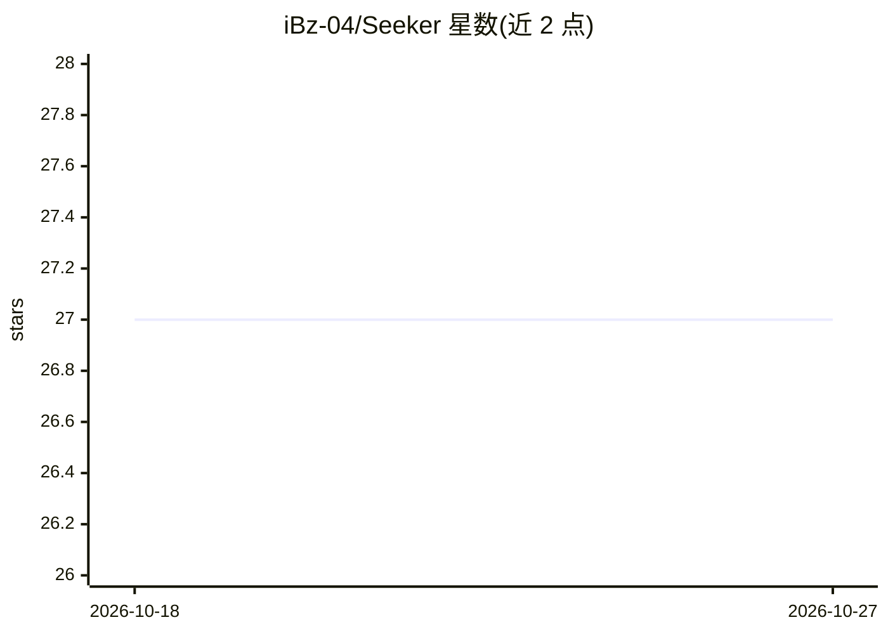

# iBz-04/Seeker

⭐ 27 · TypeScript · MIT · 推送 2026-10-18 · [GitHub](https://github.com/iBz-04/Seeker) · [官网](https://viralway.co) · 个人维护

**深度研究助手：把粗略提问转为结构化答案或长报告**

Seeker 通过迭代式网络搜索、追问澄清与 LLM 综合生成研究产出，支持 answer 与 report 两种输出模式，报告以 Markdown 与 .docx 两种文件保存并可在前端下载。搜索默认使用无需账号的 Parallel Search MCP，也可配置 Firecrawl（含自托管端点）。仓库含 Node.js 后端（研究引擎、CLI、API 服务器）、Next.js 聊天前端，提供 docker-compose 本地容器配置与 render.yaml 部署模板。广度限 1-10，深度限 1-5，匿名搜索服务有用量限制。

## 筛选速览

| 维度 | 判定 | 备注 |
|---|---|---|
| AI 角色 | `ai-native` | 本体是模型或模型工具 |
| 许可风险 | `permissive` | MIT |
| 部署形态 | `library` | 以包/库形式分发 |
| 模型依赖 | — | README 未给出锁定关系 |
| 硬件要求 | — | 无带数字的原话,不猜 |
| 安装摩擦 | `low` | 无编译、无系统依赖或容器化 |
| 成熟度 | — | 结构信号不足 |

## 能力要点

- 迭代搜索+追问+综合的研究循环
- 报告导出为 Markdown 与 .docx 并支持前端下载
- 搜索提供方可配置：Parallel Search MCP / Firecrawl（含自托管）
- 提供后端 API、CLI 与 Next.js 前端三种使用方式

## 适用场景

- 把一个粗略问题自动研究成长篇带来源的报告
- 通过对话生成可直接下载分享的 Word/Markdown 报告
- 部署一个可配置搜索提供方的深度研究服务

## 场景标签

`科研工具` · 领域:学习与行业

## 证据(README 行号)

> L3: Seeker is a deep research assistant that turns a rough prompt into a structured answer or a long-form report. It use
> L7: - Runs a research loop over web sources and LLM synthesis.

## 星数曲线

2026-10-18 27 → 2026-10-27 27（+0）

---
*卡片 v1 · prompt 1.4 · 生成 2026-10-26 · 置信度 high · 依据 README sha `7488a49124fc` · [字段定义](../../DATASET.md)*
