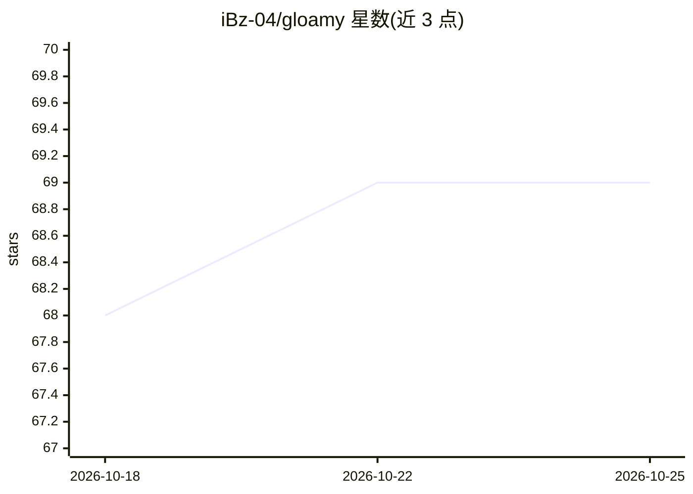

# iBz-04/gloamy

⭐ 69 · Rust · MIT · 推送 2026-10-05 · [GitHub](https://github.com/iBz-04/gloamy) · [官网](https://gloamy.co) · 个人维护

**本地优先的安全个人 AI 代理，代用户执行任务**

Rust 编写的个人 agent 运行时：以 trait 化的子系统契约（Provider/Channel/Tool/Memory/Observer/RuntimeAdapter/Peripheral）组织，可在终端对话、后台守护进程、OS 服务三种模式运行，接入 Telegram/Discord/Slack/WhatsApp 等消息通道，执行工具与脚本并跨会话记忆。支持 OpenAI、Anthropic、Gemini、DeepSeek 等直连与 OpenAI 兼容端点；内置 HTTP/WebSocket 网关与 Vue 3 Web UI，另含可选的树莓派机器人 crate。通过 crates.io cargo install 安装或 Docker 部署；README 声明处于早期开发阶段，可能有破坏性变更，并提供从 OpenClaw 迁移记忆的命令。

## 筛选速览

| 维度 | 判定 | 备注 |
|---|---|---|
| AI 角色 | `ai-native` | 本体是模型或模型工具 |
| 许可风险 | `permissive` | MIT |
| 部署形态 | `self-host` | docker 或自建部署 |
| 模型依赖 | — | README 未给出锁定关系 |
| 硬件要求 | — | 无带数字的原话,不猜 |
| 安装摩擦 | `low` | 无编译、无系统依赖或容器化 |
| 成熟度 | `idea` | |

## 能力要点

- 七类显式子系统契约的可插拔架构（Provider/Channel/Tool/Memory 等）
- Telegram、Discord、Slack、Matrix、WhatsApp、iMessage 等多消息通道守护运行
- 安全默认（fail closed）、权限控制的应用操作与一次性配对码网关
- 独立机器人 crate 支持树莓派等硬件的感知/运动/语音实验

## 适用场景

- 让一个本地运行的 AI 代理持续在线处理我的消息并代执行任务
- 通过 Telegram 等聊天通道远程指挥代理在电脑上运行工具
- 在树莓派硬件上实验机器人控制与设备集成

## 场景标签

`AI 助手` · 领域:对话与助手

## 证据(README 行号)

> L28: The project goal is simple: Local first agents for real-world tasks
> L32: Gloamy can:
> L39: - run tools and scripts on your computer or online, safely

## 星数曲线

2026-10-18 68 → 2026-10-25 69（+1）

---
*卡片 v1 · prompt 1.4 · 生成 2026-10-24 · 置信度 mid · 依据 README sha `755ea1f331db` · [字段定义](../../DATASET.md)*
