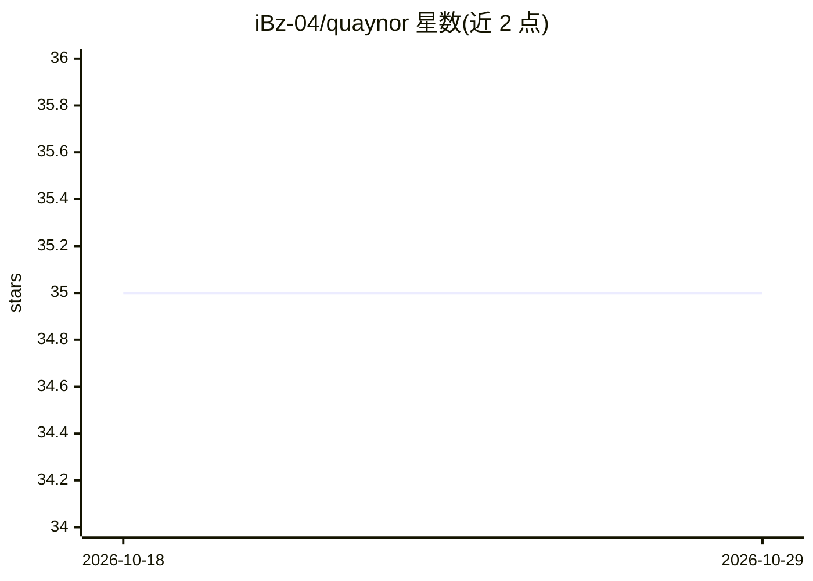

# iBz-04/quaynor

⭐ 35 · Rust · GPL-3.0 · 推送 2026-08-29 · [GitHub](https://github.com/iBz-04/quaynor) · [官网](https://www.quaynor.site) · 个人维护

**Rust 编写的跨平台本地 LLM 推理引擎及多语言绑定**

以 Rust 为核心的本地 AI 推理引擎，加载 GGUF 格式模型，支持 Vulkan（桌面/Android）与 Metal（Apple）GPU 后端，提供流式聊天补全、Minijinja 聊天模板、可选 embeddings 与 cross-encoder 重排、GBNF 语法约束的函数调用。面向希望在应用中嵌入本地 LLM 的开发者，通过 Python、Flutter、React Native、Swift、Kotlin 绑定提供统一 API，模型可从本地路径或 Hugging Face 下载，无需推理 API key。引擎与各绑定以 Cargo workspace 等形式分仓组织。

## 筛选速览

| 维度 | 判定 | 备注 |
|---|---|---|
| AI 角色 | `ai-ecosystem` | LLM/agent 周边工具 |
| 许可风险 | `viral` | GPL-3.0 |
| 部署形态 | `library` | 以包/库形式分发 |
| 模型依赖 | — | README 未给出锁定关系 |
| 硬件要求 | — | 无带数字的原话,不猜 |
| 安装摩擦 | `low` | 无编译、无系统依赖或容器化 |
| 成熟度 | — | 结构信号不足 |

## 能力要点

- 加载 GGUF 模型，支持 Vulkan/Metal GPU 后端
- Python/Flutter/React Native/Swift/Kotlin 多语言绑定的统一 Chat API
- 流式补全、embeddings、cross-encoder 重排与 GBNF 语法约束工具调用
- 离线推理，模型从本地路径或 Hugging Face 下载，无需 API key

## 适用场景

- 在移动 App 中嵌入离线运行的本地 LLM 聊天
- 跨平台（桌面/Android/iOS）项目复用同一套聊天 API
- 在应用内实现带语法约束的工具调用与流式回复

## 场景标签

`推理引擎` · 领域:训练与推理

## 证据(README 行号)

> L5:  A lightweight, blazing fast AI inference engine written in Rust.
> L7: Embed **local LLMs** in your app: load GGUF checkpoints, chat on-device or on the GPU, and keep data off the cloud. 
> L13: - **Runtime:** Rust core that loads **GGUF** models and using **Vulkan** or **Metal** where the platform enables GP

## 星数曲线

2026-10-18 35 → 2026-10-29 35（+0）

---
*卡片 v1 · prompt 1.4 · 生成 2026-10-25 · 置信度 high · 依据 README sha `718b4b8caa07` · [字段定义](../../DATASET.md)*
