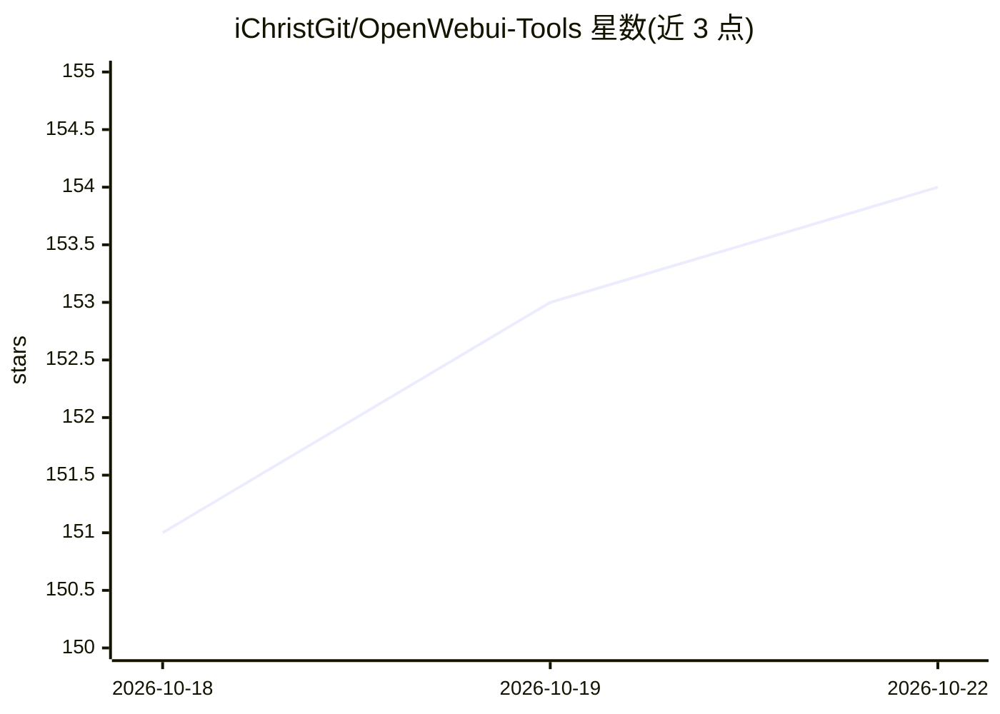

# iChristGit/OpenWebui-Tools

⭐ 154 · Python · MIT · 推送 2026-10-18 · [GitHub](https://github.com/iChristGit/OpenWebui-Tools) · [官网](https://openwebui.com/u/ichrist) · 个人维护

**面向 Open WebUI 的自定义聊天工具集：媒体、资讯与生成等 27 个**

为 Open WebUI 聊天界面提供的一组自定义工具（函数插件），共 27 个，覆盖 6 大类：媒体娱乐（Jellyfin/YouTube/新闻/Reddit/播客/歌词/电台）、体育游戏、AI 工作流（思考过滤、Personas、Orchestrator 等）、信息参考（天气/维基/股票）、图像视频生成（LTX Video/Qwen Edit/RTX Upscale，需本地 GPU 或 ComfyUI）与实用工具。多数工具零配置、无需 API key，通过 openwebui.com 一键安装，LLM 在对话中自动触发工具调用。

## 筛选速览

| 维度 | 判定 | 备注 |
|---|---|---|
| AI 角色 | `ai-ecosystem` | LLM/agent 周边工具 |
| 许可风险 | `permissive` | MIT |
| 部署形态 | `None` |  |
| 模型依赖 | — | README 未给出锁定关系 |
| 硬件要求 | — | 无带数字的原话,不猜 |
| 安装摩擦 | `medium` | 含编译或系统依赖之一 |
| 成熟度 | — | 结构信号不足 |

## 能力要点

- 27 个工具按 6 类组织，含媒体播放、资讯浏览与图像视频生成
- 多数工具零配置、无需 API key（YouTube/Reddit/播客/电台等）
- 图像视频生成工具需本地 GPU 或自托管 ComfyUI
- 工具以嵌入式 iframe 播放器/卡片形式在聊天内渲染

## 适用场景

- 在 Open WebUI 聊天中直接播放 Jellyfin/YouTube/播客/电台
- 对话中浏览 Reddit、新闻与维基等资讯并获取 AI 摘要
- 通过 ComfyUI/本地 GPU 在聊天内生成与放大图像视频

## 场景标签

`图像生成` `视频生成` · 领域:内容生成

## 证据(README 行号)

> L11: 1. **Enable the tool** — click the 🔧 icon in the chat input bar and toggle the tool on
> L14: 4. **Just ask in chat** — there are no buttons or slash commands; the LLM triggers the tool automatically when rele
> L39: |📡 **Media & Entertainment** · `7 tools`|🎬 Jellyfin · 📺 YouTube · 📰 News Reader · 🌐 Reddit · 🎙 Podcasts · 🎵 Lyrics 

## 星数曲线

2026-10-18 151 → 2026-10-22 154（+3）

---
*卡片 v1 · prompt 1.4 · 生成 2026-10-22 · 置信度 high · 依据 README sha `ad56c3577f39` · [字段定义](../../DATASET.md)*
