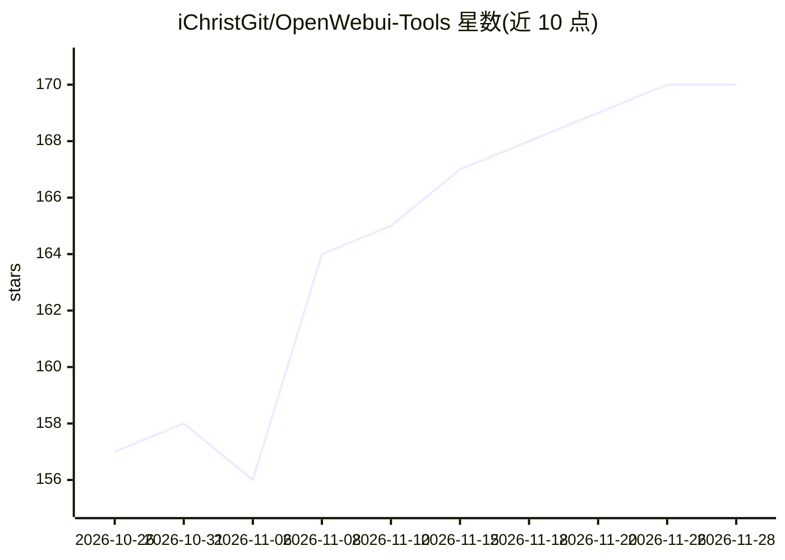

# iChristGit/OpenWebui-Tools

⭐ 170 · Python · MIT · 推送 2026-11-03 · [GitHub](https://github.com/iChristGit/OpenWebui-Tools) · [官网](https://openwebui.com/u/ichrist) · 个人维护

**为 Open WebUI 增加媒体、信息与工作流工具的集合**

面向 Open WebUI 用户的一组自定义工具（tools），由 LLM 在聊天中自动触发调用。共 29 个工具，分为媒体娱乐（Jellyfin、YouTube、新闻、Reddit、播客、歌词、电台）、体育游戏、AI 工作流、信息查询、图像视频生成、实用工具六类。多数工具零配置免 API key；图像/视频生成类需要本地 GPU 或自托管 ComfyUI；部分嵌入 UI 需开启 Open WebUI 的 iframe sandbox 设置。

## 筛选速览

| 维度 | 判定 | 备注 |
|---|---|---|
| AI 角色 | `ai-ecosystem` | LLM/agent 周边工具 |
| 许可风险 | `permissive` | MIT |
| 部署形态 | `None` |  |
| 模型依赖 | — | README 未给出锁定关系 |
| 硬件要求 | — | 无带数字的原话,不猜 |
| 安装摩擦 | `medium` | 含编译或系统依赖之一 |
| 成熟度 | — | 结构信号不足 |

## 能力要点

- 29 个工具按 6 类组织，经 openwebui.com 一键安装
- 多数工具零配置、无 API key，LLM 自动触发调用
- Jellyfin 工具支持电影/剧集/音乐/Live TV 内嵌播放
- 图像视频生成工具依赖本地 GPU / ComfyUI 实例

## 适用场景

- 在 Open WebUI 聊天中直接播放和管理 Jellyfin 媒体库
- 在对话中观看 YouTube、读新闻、逛 Reddit、听播客和电台
- 接入本地 ComfyUI 生成图像和视频
- 为聊天增加天气、维基、股票等信息查询能力

## 场景标签

`图像生成` `视频生成` · 领域:内容生成

## 证据(README 行号)

> L11: 1. **Enable the tool** — click the 🔧 icon in the chat input bar and toggle the tool on
> L14: 4. **Just ask in chat** — there are no buttons or slash commands; the LLM triggers the tool automatically when rele
> L46: > ⚙️ Image & Video Generation tools require a local GPU / ComfyUI instance.

## 星数曲线

2026-10-26 157 → 2026-11-28 170（+13）

---
*卡片 v1 · prompt 1.4 · 生成 2026-11-26 · 置信度 mid · 依据 README sha `8bddba6a123e` · [字段定义](../../DATASET.md)*
