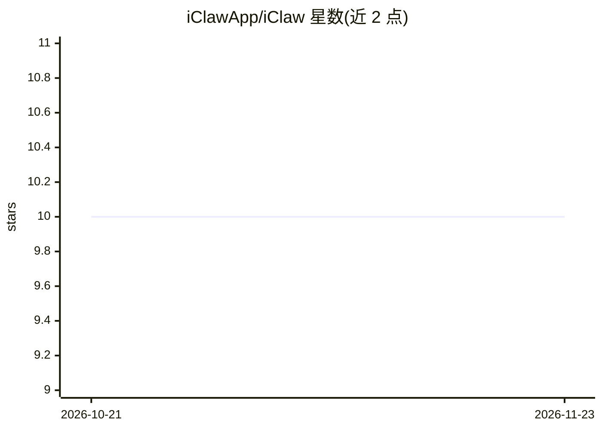

# iClawApp/iClaw

⭐ 10 · TypeScript · MIT · 推送 2026-08-31 · [GitHub](https://github.com/iClawApp/iClaw) · [官网](https://iclaw.digital) · 组织维护

**面向项目隔离使用的极简 agent UI：沙箱运行、按项目封存记忆与文件夹**

基于 Node.js 的本地自托管 agent 界面，提供四种聊天模式：Work（编辑指定文件夹并逐项审批）、Safe work（Docker 沙箱运行不可信代码并联网调研）、Full Power（接入 OpenClaw Gateway 的完整 agent）、Incognito（只读不留痕）。三个运行时模式需 Docker 与 OpenRouter key，缺失时回退到 Full Power。每个项目拥有独立聊天、记忆与文件夹，仅本机回环通信；支持 AES-256-GCM 加密自毁分享链接与远程访问隧道。

## 筛选速览

| 维度 | 判定 | 备注 |
|---|---|---|
| AI 角色 | `ai-ecosystem` | LLM/agent 周边工具 |
| 许可风险 | `permissive` | MIT |
| 部署形态 | `library` | 以包/库形式分发 |
| 模型依赖 | locked-api |  |
| 硬件要求 | — | 无带数字的原话,不猜 |
| 安装摩擦 | `low` | 无编译、无系统依赖或容器化 |
| 成熟度 | — | 结构信号不足 |

## 能力要点

- 四种信任级别模式，Docker 沙箱内运行不可信代码
- 项目级隔离：独立聊天、记忆与文件夹
- 模型无关：内置 DeepSeek + Gemini，可经 OpenRouter 接入其他模型
- npm/npx 一条命令安装，端到端加密自毁分享链接

## 适用场景

- 在沙箱中让 agent 检查不可信的 shell 脚本
- 多项目并行使用时避免记忆与文件互相串扰
- 自选模型驱动的本地个人助手部署

## 场景标签

`AI 助手` · 领域:对话与助手

## 证据(README 行号)

> L37: |**Full Power** (default)|The full OpenClaw agent — files, tools, shell, browser.|OpenClaw Gateway|
> L40: The three runtime modes need **Docker** running and an **OpenRouter key** (Settings); without either the composer f
> L49: iClaw runs untrusted code in a Docker sandbox where the command *literally cannot

## 星数曲线

2026-10-21 10 → 2026-11-23 10（+0）

---
*卡片 v1 · prompt 1.4 · 生成 2026-11-19 · 置信度 high · 依据 README sha `d470885d3a6e` · [字段定义](../../DATASET.md)*
