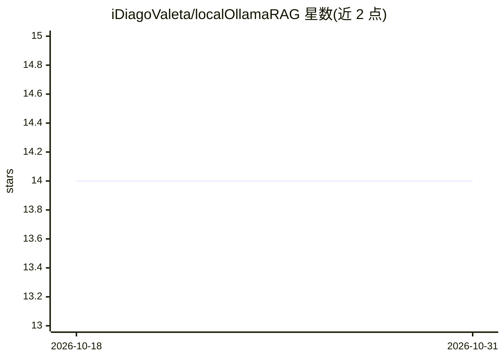

# iDiagoValeta/localOllamaRAG

⭐ 14 · Python · MIT · 推送 2026-10-30 · [GitHub](https://github.com/iDiagoValeta/localOllamaRAG) · 个人维护

**本地多模态 RAG 应用：用自有模型对 PDF 提问并获得有据回答**

MonkeyGrab 是一个本地优先的多语言 RAG 系统：MinerU 解析 PDF 结构（文本、表格、图像），embeddinggemma-2 将文本与图像映射到同一语义空间，FAISS 做精确余弦检索并与 BM25 经 RRF 融合，BGE Reranker v2 M3 重排，最后由 Ollama 模型生成回答。提供 Flask+React 网页界面、Windows 打包桌面应用与 headless HTTP 服务；四个模型角色可分别配置，另有 4GB 显存的 rag-lite 变体。运行需 Python 3.10+、本地 Ollama 及 llama-server 提供嵌入服务。

## 筛选速览

| 维度 | 判定 | 备注 |
|---|---|---|
| AI 角色 | `ai-native` | 本体是模型或模型工具 |
| 许可风险 | `permissive` | MIT |
| 部署形态 | `desktop` | 安装包/桌面程序 |
| 模型依赖 | local-ok | 支持本地模型 |
| 硬件要求 | `gpu-8g` | |
| 安装摩擦 | `medium` | 含编译或系统依赖之一 |
| 成熟度 | — | 结构信号不足 |

## 能力要点

- MinerU+embeddinggemma-2 的多模态索引，文字问题可直接检索图像
- 向量检索与 BM25 经 RRF 融合后再由 BGE 交叉编码器重排
- 索引、检索、生成全部本地运行，无需 API key
- 网页、桌面与 headless 服务共用同一条六边形架构流水线

## 适用场景

- 对本机 PDF 资料用自然语言提问，得到基于原文的回答
- 在无外发数据要求下搭建本地文档问答
- 通过 headless API 将本地 RAG 嵌入其他应用

## 场景标签

`文档问答` · 领域:知识与检索

## 证据(README 行号)

> L31: - **Local-first** — indexing, retrieval and generation all run on your hardware; Ollama provides the language model
> L75: the strongest evidence; and only then does Ollama write the answer.

## 星数曲线

2026-10-18 14 → 2026-10-31 14（+0）

---
*卡片 v1 · prompt 1.4 · 生成 2026-10-31 · 置信度 high · 依据 README sha `96447d999720` · [字段定义](../../DATASET.md)*
