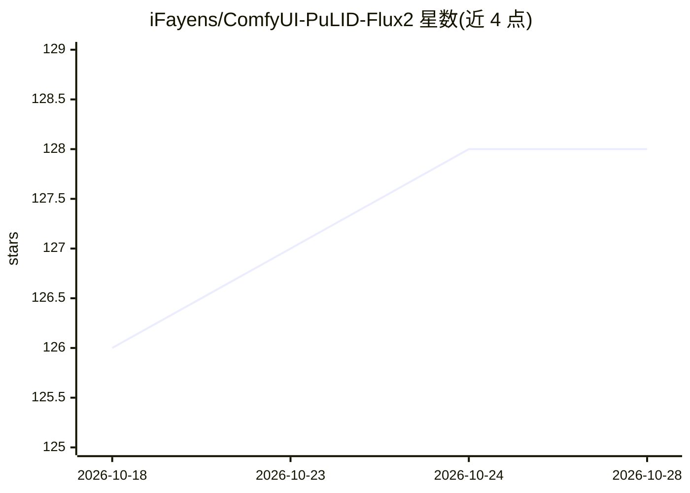

# iFayens/ComfyUI-PuLID-Flux2

⭐ 128 · Python · MIT · 推送 2026-05-21 · [GitHub](https://github.com/iFayens/ComfyUI-PuLID-Flux2) · 个人维护

**ComfyUI 节点：为 FLUX.2 图像生成保持人脸一致性**

PuLID 方法在 FLUX.2（Klein 4B/9B 与 Dev）上的 ComfyUI 自定义节点实现。通过 InsightFace 提取人脸嵌入、EVA-CLIP 提取视觉特征，转换为 identity tokens 注入 Flux.2 模型，实现跨次生成的人脸一致性。安装方式为 git clone 到 custom_nodes 目录并 pip 安装依赖，需另行下载 PuLID 权重与 InsightFace AntelopeV2 模型；训练脚本因不稳定已暂时移除。

## 筛选速览

| 维度 | 判定 | 备注 |
|---|---|---|
| AI 角色 | `ai-native` | 本体是模型或模型工具 |
| 许可风险 | `permissive` | MIT |
| 部署形态 | `library` | 以包/库形式分发 |
| 模型依赖 | — | README 未给出锁定关系 |
| 硬件要求 | — | 无带数字的原话,不猜 |
| 安装摩擦 | `low` | 无编译、无系统依赖或容器化 |
| 成熟度 | — | 结构信号不足 |

## 能力要点

- PuLID 在 Flux.2（Klein 4B/9B 与 Dev）上的适配实现
- InsightFace 人脸嵌入 + EVA-CLIP 特征注入 Flux.2 模型
- 提供 5 个节点，含 Apply PuLID 主节点与 Face Debug Preview
- 兼容已有 PuLID 权重并提供原生 Flux.2 权重（v1/v2）

## 适用场景

- 在 ComfyUI 中用 Flux.2 生成同一人物的多张图像
- 角色设定图、人像系列的批量生成
- 调试人脸嵌入与识别效果（Face Debug Preview 节点）

## 场景标签

`图像生成` · 领域:内容生成

## 证据(README 行号)

> L3: 🔥 Bring consistent identity to FLUX.2 in one node
> L33: * Face embedding → InsightFace
> L36: * Injected into Flux.2 model

## 星数曲线

2026-10-18 126 → 2026-10-28 128（+2）

---
*卡片 v1 · prompt 1.4 · 生成 2026-10-23 · 置信度 mid · 依据 README sha `160a66834cc9` · [字段定义](../../DATASET.md)*
