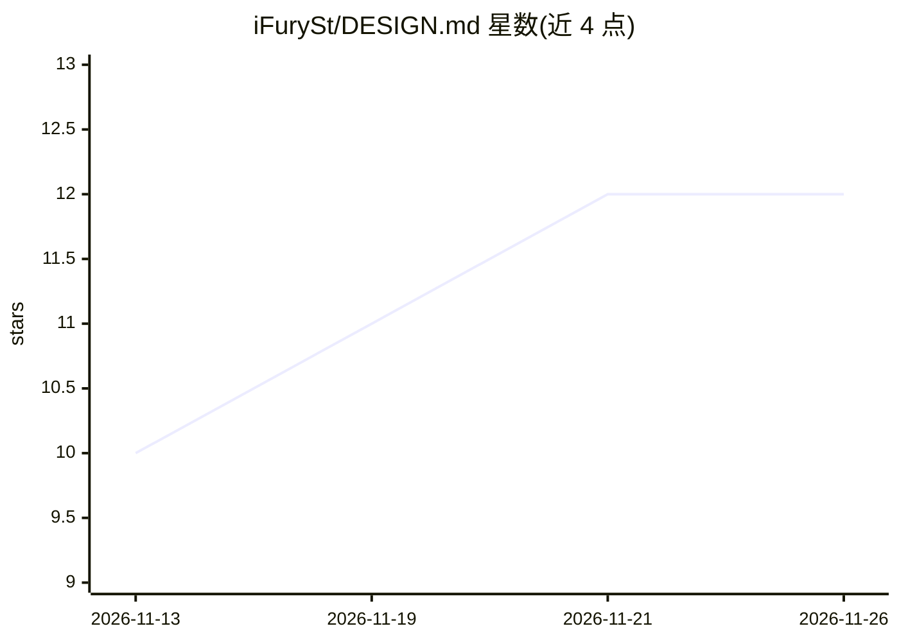

# iFurySt/DESIGN.md

⭐ 12 · HTML · MIT · 推送 2026-07-14 · [GitHub](https://github.com/iFurySt/DESIGN.md) · [官网](https://www.ifuryst.com/DESIGN.md/) · 个人维护 · 中文 README

**为 AI 编码代理生成一致 UI 的设计系统文件合集**

面向 AI coding agent 的纯文本设计系统格式（DESIGN.md）合集，收录从真实网站提取的 60 余条目，每条含 DESIGN.md 与明暗两版 preview.html。使用方式：将选定文件复制到项目根目录，指示 AI agent 以其作为视觉系统生成风格一致的 UI。仓库另提供 design-md-creator 技能，可通过 npx skills 安装到 Codex，用于从公开网站 URL 生成新的 DESIGN.md 文件。

## 筛选速览

| 维度 | 判定 | 备注 |
|---|---|---|
| AI 角色 | `ai-knowledge` | 知识聚合/清单类 |
| 许可风险 | `permissive` | MIT |
| 部署形态 | `library` | 以包/库形式分发 |
| 模型依赖 | — | README 未给出锁定关系 |
| 硬件要求 | — | 无带数字的原话,不猜 |
| 安装摩擦 | `low` | 无编译、无系统依赖或容器化 |
| 成熟度 | — | 结构信号不足 |

## 能力要点

- 60+ 条源自真实网站的 DESIGN.md，按行业分类组织
- 每条目含 preview.html 与 preview-dark.html 预览文件
- 提供 design-md-creator 技能，经 npx skills 安装到 Codex
- 中英双语 README，公开设计页面托管于 ifuryst.com

## 适用场景

- 让编码代理按指定品牌风格生成前端 UI
- 在项目中保持多个页面/组件的视觉一致性
- 从公开网站 URL 提取生成新的设计系统文件

## 场景标签

`提示工程` · 领域:Agent 开发

## 证据(README 行号)

> L15: Reusable `DESIGN.md` files extracted from real websites for AI coding and design agents.
> L17: Copy a site's `DESIGN.md` into your project, tell your agent to follow it, and generate UI that stays visually cons
> L21: DESIGN.md is a plain-text design system format for AI agents.

## 星数曲线

2026-11-13 10 → 2026-11-26 12（+2）

---
*卡片 v1 · prompt 1.4 · 生成 2026-11-19 · 置信度 high · 依据 README sha `34450d673470` · [字段定义](../../DATASET.md)*
