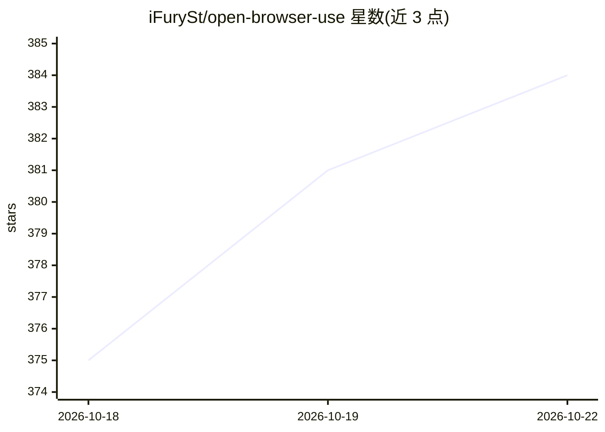

# iFurySt/open-browser-use

⭐ 390 · JavaScript · MIT · 推送 2026-10-15 · [GitHub](https://github.com/iFurySt/open-browser-use) · [官网](https://www.ifuryst.com/en/blog/2026/open-browser-use/) · 个人维护 · 中文 README

**面向 AI agent 的平台中立浏览器自动化层（CLI+SDK+扩展）**

供 AI agent 运行时接入的真实 Chrome 自动化层：由浏览器扩展与 open-browser-use CLI 组成，通过 JavaScript/Python/Go SDK 或 CLI 集成，基于 Chrome DevTools Protocol 提供标签页管理、导航、动作计划等工具；另提供 MCP server、可直接安装的 skill 包，以及尚未发布到 npm 的 Electron 内嵌浏览器工作区（open-browser-use-electron）。README 自述为 Codex.app 中 Chrome Browser Use 能力的开源替代。MIT 许可。

## 筛选速览

| 维度 | 判定 | 备注 |
|---|---|---|
| AI 角色 | `ai-ecosystem` | LLM/agent 周边工具 |
| 许可风险 | `permissive` | MIT |
| 部署形态 | `desktop` | 安装包/桌面程序 |
| 模型依赖 | — | README 未给出锁定关系 |
| 硬件要求 | — | 无带数字的原话,不猜 |
| 安装摩擦 | `low` | 无编译、无系统依赖或容器化 |
| 成熟度 | `idea` | |

## 能力要点

- 浏览器扩展 + CLI 配合 CDP 实现真实 Chrome 自动化
- 提供 JS/Python/Go 三种 SDK 与 CLI 集成方式
- 支持 MCP server 与 npx skills 安装到 Codex 等 agent
- 含 Electron 内嵌浏览器变体（多标签任务域、命名 profile、私有工具通道，未发布 npm）

## 适用场景

- 让 AI agent 在真实 Chrome 中执行浏览与操作任务
- 通过 MCP 或 skill 把浏览器工具接入 agent 运行时
- 在 Electron 应用内嵌可控浏览器供 agent 使用

## 场景标签

`浏览器自动化` · 领域:效率与自动化

## 证据(README 行号)

> L14: `open-browser-use` is a browser automation layer that stays neutral across
> L19: Under the hood, it pairs a browser extension with the `open-browser-use` CLI.

## 星数曲线

2026-10-18 375 → 2026-10-22 384（+9）

---
*卡片 v1 · prompt 1.4 · 生成 2026-10-21 · 置信度 high · 依据 README sha `4ade1b7aa96d` · [字段定义](../../DATASET.md)*
