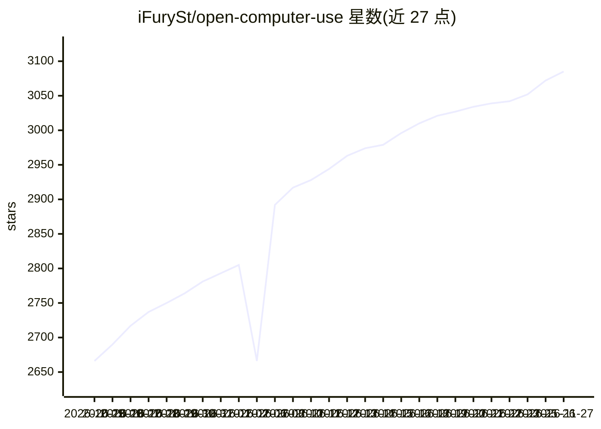

# iFurySt/open-computer-use

⭐ 3,085 · Swift · MIT · 推送 2026-11-23 · [GitHub](https://github.com/iFurySt/open-computer-use) · 个人维护 · 中文 README

**为 AI agent 提供 MCP 封装的跨平台 Computer Use 服务**

将 Computer Use 能力封装为 MCP 服务的开源项目，任何 AI agent 或 MCP 客户端可接入后在 macOS、Linux、Windows 上执行桌面自动化操作。基于系统 Accessibility 实现非侵入式 CUA，灵感来自 OpenAI Codex Computer Use。提供 npm/Homebrew 安装，内置 install-codex-mcp 命令写入客户端配置，支持 Codex App/CLI 与 Gemini CLI 演示，并提供可安装到 Codex/Claude Code 的 skill。macOS 运行时要求 14.0+ 并需授予辅助功能与屏幕录制权限。

## 筛选速览

| 维度 | 判定 | 备注 |
|---|---|---|
| AI 角色 | `ai-ecosystem` | LLM/agent 周边工具 |
| 许可风险 | `permissive` | MIT |
| 部署形态 | `library` | 以包/库形式分发 |
| 模型依赖 | — | README 未给出锁定关系 |
| 硬件要求 | — | 无带数字的原话,不猜 |
| 安装摩擦 | `low` | 无编译、无系统依赖或容器化 |
| 成熟度 | — | 结构信号不足 |

## 能力要点

- 以 MCP 服务形式向任意 agent/MCP 客户端提供 Computer Use 能力
- 跨平台支持 macOS、Linux、Windows
- 基于 Accessibility 的非侵入式实现
- 提供 install-codex-mcp 一键接入与 Codex/Claude Code skill 安装

## 适用场景

- 让 Codex CLI/Gemini CLI 等客户端通过 MCP 执行桌面操作
- 为 agent 补充跨平台 Computer Use 能力
- macOS 锁屏状态下让 agent 持续执行任务（Locked Use）

## 场景标签

`GUI 自动化` `编码 Agent` · 领域:效率与自动化

## 证据(README 行号)

> L12: `open-computer-use` is an open-source `Computer Use` service wrapped as `MCP`. Any AI agent or MCP client can use i
> L69: Before using it, install it into your agent:
> L74: ocu install-codex-mcp

## 星数曲线

2026-10-25 2,666 → 2026-11-27 3,085（+419）

---
*卡片 v1 · prompt 1.4 · 生成 2026-11-23 · 置信度 high · 依据 README sha `f47279d4d65f` · [字段定义](../../DATASET.md)*
