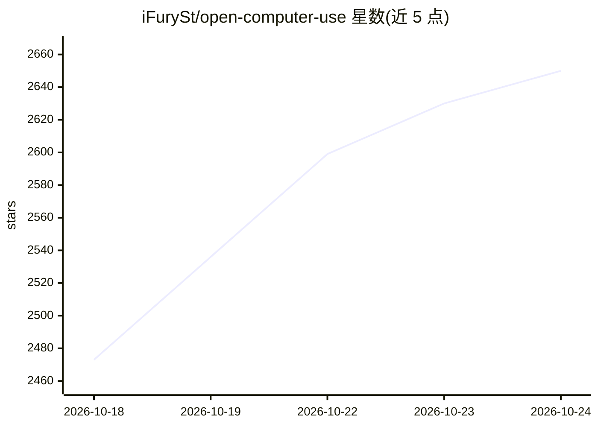

# iFurySt/open-computer-use

⭐ 2,650 · Swift · MIT · 推送 2026-10-19 · [GitHub](https://github.com/iFurySt/open-computer-use) · 个人维护 · 中文 README

**封装为 MCP 的开源 Computer Use 服务，供 AI agent 调用**

将 Computer Use（基于系统 Accessibility API 的非侵入式 GUI 操控）封装为 MCP 服务，任何 AI agent 或 MCP 客户端可在 macOS、Linux、Windows 上调用。受 OpenAI Codex Computer Use 启发，演示了接入 Codex App/CLI、Gemini CLI 与 Linux 的使用。提供 npm 全局安装与 ocu CLI，支持写入 Codex 配置的安装命令、npx skills 技能安装（Codex/Claude Code）、js/repl/mcp 子命令与 macOS 权限诊断。macOS 运行时要求 14.0 及以上并授予 Accessibility 与 Screen Recording 权限，npm 启动器需 Node.js 18+。

## 筛选速览

| 维度 | 判定 | 备注 |
|---|---|---|
| AI 角色 | `ai-ecosystem` | LLM/agent 周边工具 |
| 许可风险 | `permissive` | MIT |
| 部署形态 | `desktop` | 安装包/桌面程序 |
| 模型依赖 | — | README 未给出锁定关系 |
| 硬件要求 | — | 无带数字的原话,不猜 |
| 安装摩擦 | `low` | 无编译、无系统依赖或容器化 |
| 成熟度 | — | 结构信号不足 |

## 能力要点

- 以 MCP 服务形式暴露 Computer Use，跨 macOS/Linux/Windows
- 基于 Accessibility API 的非侵入式 CUA，无需截图定位（macOS query 按文本/角色找控件）
- ocu CLI 提供 js/repl/mcp 模式与 macOS 权限诊断（ocu doctor）
- 一键安装到 Codex（写入 config.toml）或以技能形式装给 Claude Code

## 适用场景

- 让 Codex 或 Gemini CLI 等 agent 具备操作桌面应用的能力
- 通过 MCP 接入自建客户端实现跨平台 GUI 自动化
- 在 macOS 上以 Accessibility 方式无侵入操控界面并做权限自检

## 场景标签

`GUI 自动化` · 领域:效率与自动化

## 证据(README 行号)

> L12: `open-computer-use` is an open-source `Computer Use` service wrapped as `MCP`. Any AI agent or MCP client can use i
> L14: This project was inspired by OpenAI's Codex Computer Use. It showed that non-intrusive CUA can be built on top of A
> L30:  Gemini CLI connects to `open-computer-use` through MCP and runs full Computer Use actions.

## 星数曲线

2026-10-18 2,473 → 2026-10-24 2,650（+177）

---
*卡片 v1 · prompt 1.4 · 生成 2026-10-21 · 置信度 high · 依据 README sha `be127a242f3b` · [字段定义](../../DATASET.md)*
