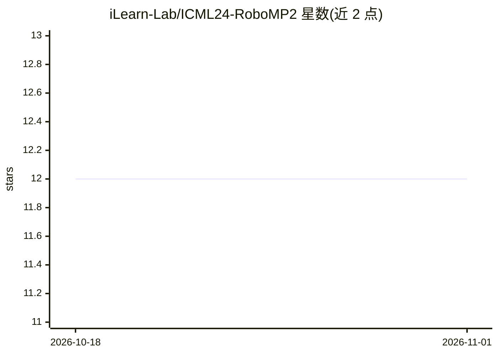

# iLearn-Lab/ICML24-RoboMP2

⭐ 12 · Python · Apache-2.0 · 推送 2026-04-04 · [GitHub](https://github.com/iLearn-Lab/ICML24-RoboMP2) · [官网](https://aopolin-lv.github.io/RoboMP2.github.io/) · 组织维护 · 中文 README

**ICML 2024 机器人操作任务的多模态感知-规划框架论文代码**

RoboMP2 的官方代码库：将 VIMABench 任务描述与场景观测转化为可执行动作程序。流程为提示接地、指令改写（GPT-4）、TF-IDF 与 Sentence-BERT 粗细粒度检索示例与 API、GPT-4V 生成可执行代码，再由操作基元在 VIMABench 仿真器中执行。提供评测脚本、检索模块、机器人操作基元，需自行安装 VIMABench 并配置 OpenAI API key 与本地 MLLM 检查点路径。论文报告 VIMABench 平均 82.4 分。

## 筛选速览

| 维度 | 判定 | 备注 |
|---|---|---|
| AI 角色 | `ai-ecosystem` | LLM/agent 周边工具 |
| 许可风险 | `permissive` | Apache-2.0 |
| 部署形态 | `library` | 以包/库形式分发 |
| 模型依赖 | — | README 未给出锁定关系 |
| 硬件要求 | — | 无带数字的原话,不猜 |
| 安装摩擦 | `low` | 无编译、无系统依赖或容器化 |
| 成熟度 | — | 结构信号不足 |

## 能力要点

- 检索增强提示：指令改写 + TF-IDF/Sentence-BERT 粗细排序
- GPT-4V 基于当前场景图像生成可执行代码
- 内置 PickPlace、RotateAll 等机器人操作基元
- 覆盖 VIMABench 四种泛化分区的评测脚本

## 适用场景

- 复现 ICML 2024 论文的 VIMABench 评测结果
- 研究 MLLM 驱动的机器人操作程序生成
- 在 VIMABench 上对比检索增强规划方法

## 场景标签

`RAG` `多模态` `模型评测` · 领域:评测与运维

## 证据(README 行号)

> L3: > **[ICML 2024]** A robotic multimodal perception-planning framework that combines retrieval-augmented prompting, mu
> L27: RoboMP 2 is a robotic multimodal perception-planning framework for manipulation tasks. This repository contains the

## 星数曲线

2026-10-18 12 → 2026-11-01 12（+0）

---
*卡片 v1 · prompt 1.4 · 生成 2026-11-01 · 置信度 mid · 依据 README sha `5c15bc58b936` · [字段定义](../../DATASET.md)*
