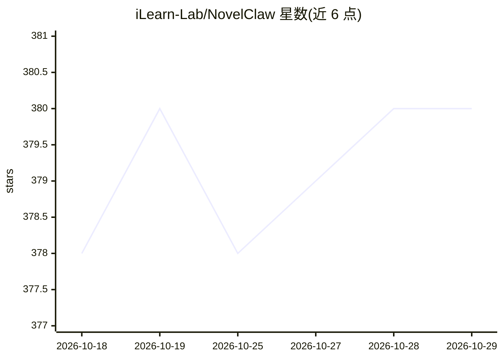

# iLearn-Lab/NovelClaw

⭐ 380 · Python · MIT · 推送 2026-10-12 · [GitHub](https://github.com/iLearn-Lab/NovelClaw) · [官网](https://hitsz-ds.github.io/CoLong-Idea-Studio/) · 组织维护 · 中文 README

**面向长篇小说写作的 FastAPI 工作区：会话、章节与记忆管理**

基于 FastAPI 与 Python 3.10+ 的长篇小说写作工作区，将写作组织为持续会话、章节草稿、run 检查（worker.log/progress.log/章节文件）与稿件评审；提供故事板、世界/角色/风格面板和可编辑记忆库等延续性控制面。使用前需在 /console/models 配置模型供应商 API key，也可添加自定义供应商。部署方式包括 Docker 脚本（docker-start.bat/.sh）、Windows 一键 START_LOCAL.bat 与手动 PowerShell 脚本，另有在线平台与中文文档。

## 筛选速览

| 维度 | 判定 | 备注 |
|---|---|---|
| AI 角色 | `ai-native` | 本体是模型或模型工具 |
| 许可风险 | `permissive` | MIT |
| 部署形态 | `None` |  |
| 模型依赖 | — | README 未给出锁定关系 |
| 硬件要求 | — | 无带数字的原话,不猜 |
| 安装摩擦 | `low` | 无编译、无系统依赖或容器化 |
| 成熟度 | — | 结构信号不足 |

## 能力要点

- 会话式写作 + run 级检查（worker.log、progress.log、章节产物可下载）
- 故事板/稿件/世界/角色/风格面板与可编辑记忆库
- Docker 与本地脚本两种启动方式，含中文文档与在线平台

## 适用场景

- 连载式长篇小说逐章写作与续写
- 需要跨章节一致性记忆追踪的写作项目
- 作者持续介入、人机协作的审稿与修改流程

## 场景标签

`AI 写作` · 领域:内容生成

## 证据(README 行号)

> L10:  ✨ A structured long-form fiction workspace centered on chapter drafting, inspectable runs, manuscript review, and 
> L51: - 📚 long-form fiction, serial writing, and chapter-by-chapter continuation.
> L215:  Open `/console/chat`, choose a provider, and submit an initial premise, tone, cast, or writing task. NovelClaw wi

## 星数曲线

2026-10-18 378 → 2026-10-29 380（+2）

---
*卡片 v1 · prompt 1.4 · 生成 2026-10-21 · 置信度 high · 依据 README sha `5747480700be` · [字段定义](../../DATASET.md)*
