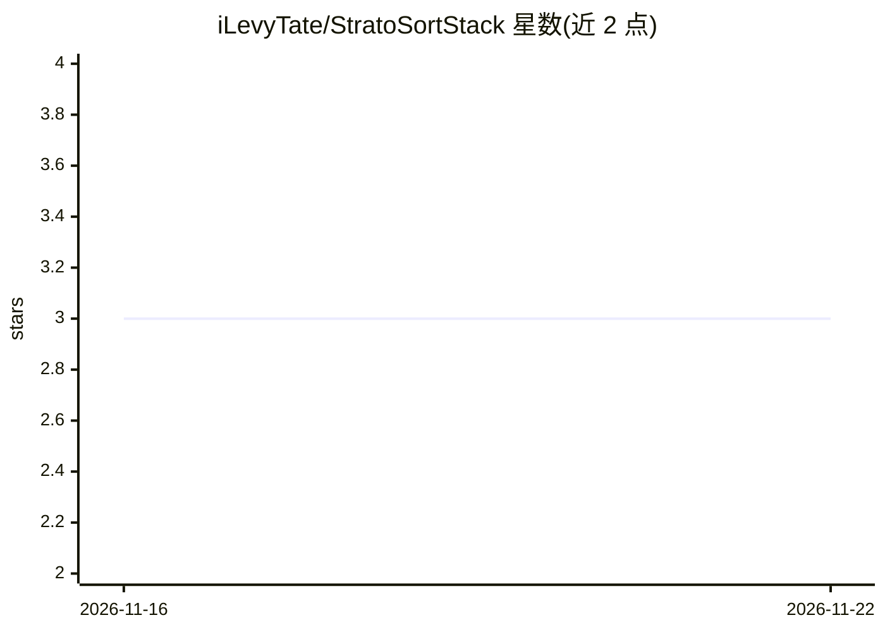

# iLevyTate/StratoSortStack

⭐ — · [GitHub]() · 个人维护

**本地离线 AI 文件整理与语义搜索桌面应用**

Electron 桌面应用，读取文档、表格、图片、音视频等 100 余种文件的内容，据此建议文件名与目标文件夹（移动前可人工逐条审核并可撤销），并提供语义搜索、带来源的文档问答、知识图谱（Relate/Atlas）与近重复检测。AI 推理通过 node-llama-cpp 本地运行，支持本地 Whisper 转录与视觉/OCR；可选接入 Anthropic 或 OpenAI 兼容云模型处理部分任务，搜索与嵌入始终本地。提供 Windows/macOS/Linux 安装包，也可 Node.js 源码构建。

## 筛选速览

| 维度 | 判定 | 备注 |
|---|---|---|
| AI 角色 | `ai-native` | 本体是模型或模型工具 |
| 许可风险 | `none` | — |
| 部署形态 | `desktop` | 安装包/桌面程序 |
| 模型依赖 | — | README 未给出锁定关系 |
| 硬件要求 | — | 无带数字的原话,不猜 |
| 安装摩擦 | `medium` | 含编译或系统依赖之一 |
| 成熟度 | — | 结构信号不足 |

## 能力要点

- 本地推理：无账号、无云服务、无遥测，模型一次性下载约 7–10 GB
- 按内容建议文件名与文件夹，人工审核后执行且可撤销
- 语义搜索与带来源的文档问答，支持 100+ 文件类型
- 可选本地 MCP 服务器供 Claude Desktop/Cursor/Zed 检索文件

## 适用场景

- 把杂乱下载/文档目录自动整理成清晰命名与归类
- 在本地隐私环境下对私人文档做语义搜索与问答
- 语音或扫描内容（Whisper 转录/OCR）纳入统一检索
- 通过 MCP 让本地 AI 工具检索本地文件而不上传

## 场景标签

`文档问答` `语义搜索` `知识图谱` · 领域:知识与检索

## 证据(README 行号)

> L25: questions across all of them. The AI runs on your machine: there is no account, no cloud service and
> L40: - **Reads images, scans and recordings.** Vision and OCR for photos, screenshots and scanned PDFs;
> L140: node-llama-cpp for local inference and Orama for search; see Architecture

## 星数曲线

2026-11-16 3 → 2026-11-22 3（+0）

---
*卡片 v1 · prompt 1.4 · 生成 2026-11-21 · 置信度 high · 依据 README sha `4c8f94ca8217` · [字段定义](../../DATASET.md)*
