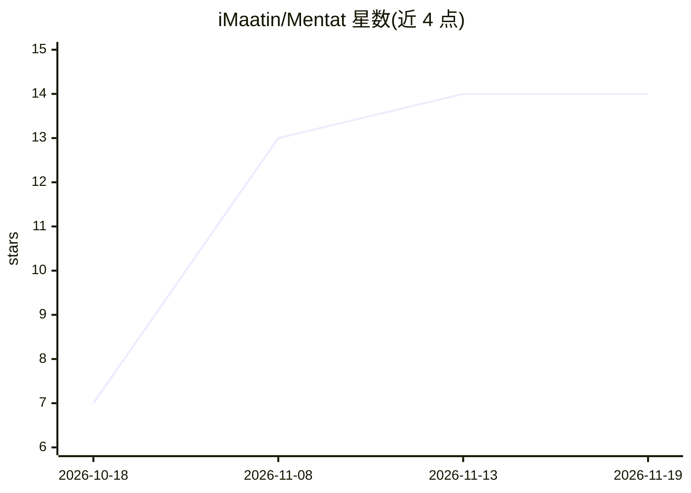

# iMaatin/Mentat

⭐ 14 · TypeScript · MIT · 推送 2026-10-11 · [GitHub](https://github.com/iMaatin/Mentat) · 个人维护

**双层编码 agent：本地模型构建沙盒镜像，云端模型只见脱敏代码**

面向需要代码修改但不愿将仓库交给云端 LLM 的开发者：本地模型（经 LM Studio 运行）理解请求与仓库，构建结构相同但标识符/数据被替换的合成镜像，交由云端模型（经 opencode CLI，默认 anthropic/claude-opus-5-5）在沙盒内修改，再经 token 还原把补丁写回真实仓库。出站前有双重 egress 门（引用检查不可绕过、内容扫描需人工批准），敏感文件（.env、*.pem 等）不进入镜像。数据集 mock 保持分布、相关性与缺失结构。需 Node 20.11+、LM Studio 与 opencode CLI。

## 筛选速览

| 维度 | 判定 | 备注 |
|---|---|---|
| AI 角色 | `ai-native` | 本体是模型或模型工具 |
| 许可风险 | `permissive` | MIT |
| 部署形态 | `desktop` | 安装包/桌面程序 |
| 模型依赖 | — | README 未给出锁定关系 |
| 硬件要求 | — | 无带数字的原话,不猜 |
| 安装摩擦 | `low` | 无编译、无系统依赖或容器化 |
| 成熟度 | — | 结构信号不足 |

## 能力要点

- 本地模型构建合成镜像，云端模型不接触真实仓库
- 双重 egress 门：路径引用检查不可绕过，内容扫描发现需人工批准并留审计记录
- 数据 mock 复现缺失结构、列相关性与类别词表，标识列换新 ID
- 敏感文件（.env/*.pem/.ssh 等）完全排除在镜像外并记入任务清单

## 适用场景

- 在不泄露专有代码与数据的前提下用云端大模型改代码
- 对含客户数据的仓库做 AI 编码时的隐私边界
- 检查 AI 编码流程的出站载荷是否有真实标识符泄漏

## 场景标签

`编码 Agent` · 领域:编码与开发

## 证据(README 行号)

> L11: Mentat runs a local model first, which understands your request and your
> L13: a large cloud model. The cloud model makes the change against the mirror. Mentat
> L98: |`cloudModel`|`anthropic/claude-opus-5-5`|opencode model for layer 2, e.g. `anthropic/claude-opus-5-5`.|

## 星数曲线

2026-10-18 7 → 2026-11-19 14（+7）

---
*卡片 v1 · prompt 1.4 · 生成 2026-11-18 · 置信度 mid · 依据 README sha `ac2168173954` · [字段定义](../../DATASET.md)*
