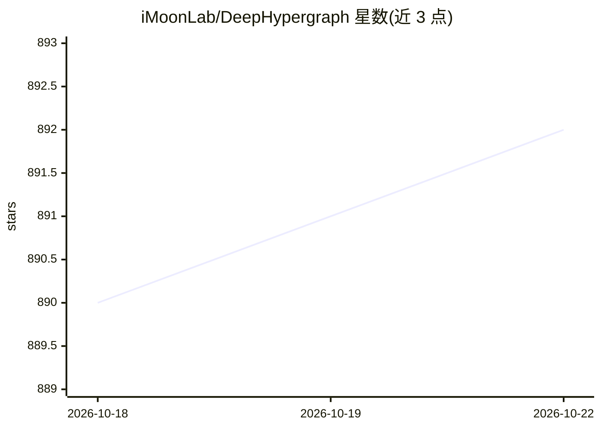

# iMoonLab/DeepHypergraph

⭐ 892 · Python · Apache-2.0 · 推送 2026-10-07 · [GitHub](https://github.com/iMoonLab/DeepHypergraph) · [官网](https://deephypergraph.com/) · 组织维护 · 中文 README

**基于 PyTorch 的图与超图神经网络计算库**

DHG（DeepHypergraph）是基于 PyTorch 的深度学习库，面向图神经网络与超图神经网络研究：支持低阶结构（图、有向图、二部图）与高阶结构（超图）的构建，内置多种低阶/高阶消息传递操作（v2v、v2e、e2v 等）与基于 Laplacian 的谱域操作；提供 30 余个公开数据集、分类/推荐/检索三类评测指标、多个 SOTA 模型实现及可视化工具；基于 Optuna 的 dhg.experiments 模块支持自动超参搜索。通过 pip 安装，依赖 Python>=3.8 与 PyTorch 1.12.1–2.0。

## 筛选速览

| 维度 | 判定 | 备注 |
|---|---|---|
| AI 角色 | `ai-native` | 本体是模型或模型工具 |
| 许可风险 | `permissive` | Apache-2.0 |
| 部署形态 | `library` | 以包/库形式分发 |
| 模型依赖 | — | README 未给出锁定关系 |
| 硬件要求 | — | 无带数字的原话,不猜 |
| 安装摩擦 | `low` | 无编译、无系统依赖或容器化 |
| 成熟度 | — | 结构信号不足 |

## 能力要点

- 低阶与高阶（超图）消息传递操作与谱域平滑
- 内置 30+ 公开图/超图数据集与 GCN/GAT/HGNN/HGNN+ 等卷积层构建示例
- 基于 Optuna 的 Auto-ML 自动调参模块
- 图与超图结构可视化及互相转换工具

## 适用场景

- 研究者在超图结构上构建并训练 HGNN 模型
- 复现图/超图顶点分类、推荐、链接预测任务的基准实验
- 自动搜索结构构建配置与模型超参数

## 场景标签

 · 领域:图机器学习/深度学习库

## 证据(README 行号)

> L27: **DHG** *(DeepHypergraph)* is a deep learning library built upon PyTorch for learning with both Graph Neural Networ
> L29: It supports a wide variety of structures like low-order structures (graph, directed graph, bipartite graph, etc.), 
> L31: In addition, DHG's dhg.experiments module (that implements **Auto-ML** upon Optuna) can help you automatically tune

## 星数曲线

2026-10-18 890 → 2026-10-22 892（+2）

---
*卡片 v1 · prompt 1.4 · 生成 2026-10-21 · 置信度 high · 依据 README sha `f95a36947e56` · [字段定义](../../DATASET.md)*
