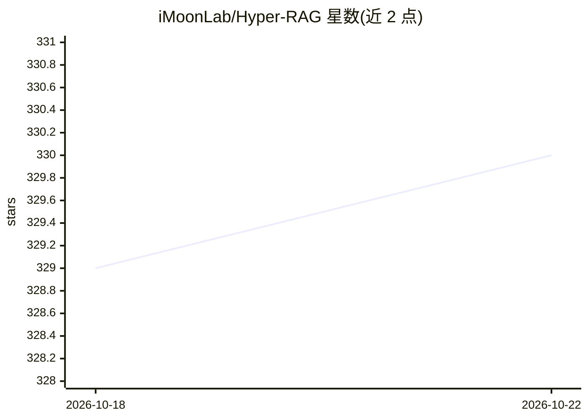

# iMoonLab/Hyper-RAG

⭐ 330 · Python · Apache-2.0 · 推送 2026-06-27 · [GitHub](https://github.com/iMoonLab/Hyper-RAG) · [官网](https://www.nature.com/articles/s41467-026-71411-1) · 组织维护

**超图驱动的 RAG 框架：建模高阶关联以降低 LLM 幻觉**

面向领域知识问答（如医学）的检索增强生成方法：从语料抽取实体与高阶关联构建超图知识库（基于 Hypergraph-DB），回答时先检索先验知识再输入 LLM 生成回复；提供轻量版 Hyper-RAG-Lite。用户需在配置文件中填入自有 LLM 的 URL/KEY/模型名。论文发表于 Nature Communications（2026）。提供分步复现脚本、Web 可视化与 QA 界面、Docker 部署（Web UI），以及打分式与选择式两种评测脚本；由清华大学 iMoon-Lab 维护，基于 LightRAG 与 Hypergraph-DB。

## 筛选速览

| 维度 | 判定 | 备注 |
|---|---|---|
| AI 角色 | `ai-ecosystem` | LLM/agent 周边工具 |
| 许可风险 | `permissive` | Apache-2.0 |
| 部署形态 | `self-host` | docker 或自建部署 |
| 模型依赖 | — | README 未给出锁定关系 |
| 硬件要求 | — | 无带数字的原话,不猜 |
| 安装摩擦 | `low` | 无编译、无系统依赖或容器化 |
| 成熟度 | — | 结构信号不足 |

## 能力要点

- 超图建模实体间超越成对的高阶关联，降低信息损失
- 轻量版 Hyper-RAG-Lite 提升检索速度
- 提供 hyper/hyper-lite/naive 多种模式与流式输出
- Web UI 超图可视化与 Docker Compose 部署

## 适用场景

- 在医学等高风险领域知识库上做问答并减少幻觉
- 复现论文实验或对比不同 RAG 方法的检索效率
- 可视化检查知识超图结构与 QA 过程

## 场景标签

`RAG` · 领域:知识与检索

## 证据(README 行号)

> L29: Large language models (LLMs) have transformed various sectors, including education, finance, and medicine, by enhan
> L33: Schematic diagram of the proposed Hyper-RAG architecture. a, The patient poses a question. b, A knowledge base is c
> L63: Copy the `config_temp.py` file to `my_config.py` in the root folder and set your LLM `URL` and `KEY`.

## 星数曲线

2026-10-18 329 → 2026-10-22 330（+1）

---
*卡片 v1 · prompt 1.4 · 生成 2026-10-21 · 置信度 high · 依据 README sha `debbaad2c3a7` · [字段定义](../../DATASET.md)*
