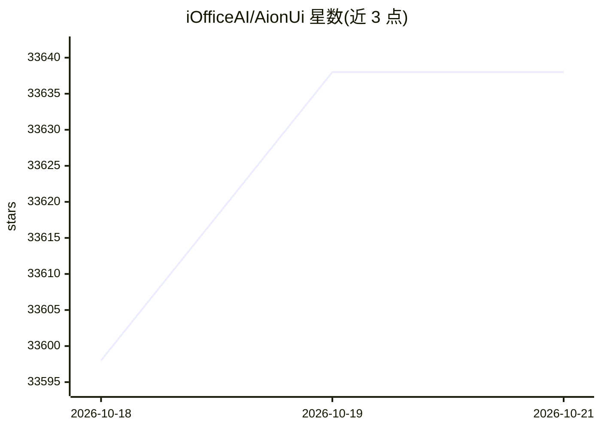

# iOfficeAI/AionUi

⭐ 33,638 · TypeScript · Apache-2.0 · 推送 2026-10-19 · [GitHub](https://github.com/iOfficeAI/AionUi) · [官网](https://www.aionui.com) · 组织维护 · 中文 README

**桌面 AI Agent 协作应用：内置 Agent 并接入 20+ CLI Agent**

开源跨平台桌面应用，定位为与 AI Agent 协同工作的 Cowork 平台。内置 aionrs Agent 引擎，粘贴任意 API Key 即可使用；同时自动检测并统一管理已安装的 CLI Agent（Claude Code、Codex、Gemini CLI、OpenClaw 等 20+）。支持 Team Mode 多 Agent 分工协作、MCP 工具统一管理、21 个内置助手（PPT/Word/Excel 生成等）、Cron 定时自动化、WebUI 远程访问及 Telegram/飞书/钉钉/微信等聊天平台接入。声称支持 30+ AI 平台含 Ollama/LM Studio 本地模型。限制：需自备 API Key，部分功能依赖外部 CLI Agent 安装。

## 筛选速览

| 维度 | 判定 | 备注 |
|---|---|---|
| AI 角色 | `ai-native` | 本体是模型或模型工具 |
| 许可风险 | `permissive` | Apache-2.0 |
| 部署形态 | `desktop` | 安装包/桌面程序 |
| 模型依赖 | local-ok | 支持本地模型 |
| 硬件要求 | — | 无带数字的原话,不猜 |
| 安装摩擦 | `low` | 无编译、无系统依赖或容器化 |
| 成熟度 | — | 结构信号不足 |

## 动量与使用信号

- 维护:`active` — 距上次 push 4.2 天,年发版 100,104 位贡献者
- 涨星:近 1 天 **+26**(自 20261016 起算)
- 平台:MACOS / LINUX / WEB · 协议:OPENAI-API / MCP / OLLAMA

## 能力要点

- 内置 aionrs Agent 引擎，安装即用无需另装 CLI 工具
- 自动检测并统一管理 20+ 外部 CLI Agent（ACP 协议接入）
- Team Mode：Leader 编排 + Teammate 并行执行 + 共享任务板
- 21 个内置助手覆盖 PPT/Word/Excel/论文等文档生成

## 适用场景

- 在一个界面里同时使用多个已安装的 CLI Agent 协作完成任务
- 让 AI Agent 生成可编辑的 PPT、Word、Excel 文档
- 通过手机 WebUI 或 Telegram/飞书远程访问 24/7 自动化任务
- 用本地 Ollama/LM Studio 模型驱动 Agent 工作

## 场景标签

`多智能体` `AI 助手` · 领域:Agent 开发

## 证据(README 行号)

> L13:  A free, open-source, Cowork app with AI Agents
> L43: **AionUi is more than a chat client.** It's a Cowork platform where AI agents work alongside you on your computer —
> L61: - **No complex setup** — paste any API key to get started
> L141: |Ollama / LM Studio (local)|Local model Cowork Agent|

## 星数曲线

2026-10-18 33,598 → 2026-10-21 33,638（+40）

---
*卡片 v1 · prompt 1.4 · 生成 2026-10-20 · 置信度 high · 依据 README sha `fc6ece1cb05b` · [字段定义](../../DATASET.md)*
