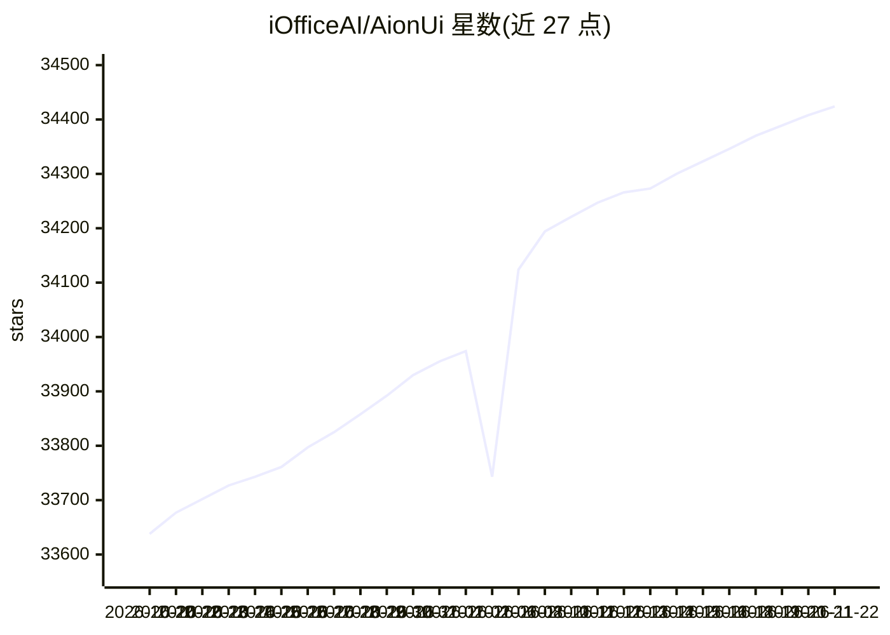

# iOfficeAI/AionUi

⭐ 34,424 · TypeScript · Apache-2.0 · 推送 2026-11-05 · [GitHub](https://github.com/iOfficeAI/AionUi) · [官网](https://www.aionui.com) · 组织维护 · 中文 README

**多 Agent 协作桌面/网页客户端：统一界面运行内置与 20+ CLI Agent**

以桌面应用（含 WebUI 模式）形式提供的 AI Agent 协作平台：内置 aionrs agent 引擎，装后即可用，贴入 API key 即获得文件读写、网页搜索、图像生成与 MCP 工具调用的 Agent 能力；同时自动检测本机已装的 Claude Code、Codex、Gemini CLI 等外部 CLI Agent 并纳入统一界面，支持并行会话与 Team Mode（Leader 拆解任务、Teammate 并行执行、异步信箱与共享任务板）。附 21 个内置助手（PPT/Word/Excel 生成、论文写作等）与三层技能体系，可通过 Telegram/Lark/钉钉/微信远程接入，支持 Cron 定时无人值守运行。

## 筛选速览

| 维度 | 判定 | 备注 |
|---|---|---|
| AI 角色 | `ai-ecosystem` | LLM/agent 周边工具 |
| 许可风险 | `permissive` | Apache-2.0 |
| 部署形态 | `desktop` | 安装包/桌面程序 |
| 模型依赖 | local-ok | 支持本地模型 |
| 硬件要求 | — | 无带数字的原话,不猜 |
| 安装摩擦 | `low` | 无编译、无系统依赖或容器化 |
| 成熟度 | — | 结构信号不足 |

## 动量与使用信号

- 维护:`active` — 距上次 push 4.2 天,年发版 100,104 位贡献者
- 涨星:近 1 天 **+26**(自 20261016 起算)
- 平台:MACOS / LINUX / WEB · 协议:OPENAI-API / MCP / OLLAMA

## 能力要点

- 内置 agent 引擎，粘贴 API key 即可使用，无需另装 CLI 工具
- 自动检测已安装的 CLI Agent（Claude Code、Codex、Gemini CLI 等）并统一管理
- Team Mode：Leader 编排子任务，Teammate 并行执行并共享工作区
- WebUI 与 Telegram/Lark/钉钉/微信集成，支持 Cron 24/7 定时任务

## 适用场景

- 在统一界面里同时操作我已装的多个 CLI Agent
- 让多个 Agent 组队分工，并行处理拆解后的子任务
- 用手机通过 Telegram/微信远程指挥电脑上的 Agent 跑任务
- 生成可编辑的 PPT/Word/Excel 文档交付物

## 场景标签

`多智能体` `聊天机器人` `编码 Agent` `图像生成` · 领域:Agent 开发

## 证据(README 行号)

> L43: **AionUi is more than a chat client.** It's a Cowork platform where AI agents work alongside you on your computer —
> L103: **Supported Agents:** Built-in Agent (powered by the embedded aionrs agent engine) • Claude Code • Codex • Qwen Co
> L108: - **Unified Interface** — one Cowork platform for all your AI agents

## 星数曲线

2026-10-20 33,638 → 2026-11-22 34,424（+786）

---
*卡片 v1 · prompt 1.4 · 生成 2026-11-22 · 置信度 high · 依据 README sha `bf151a500de1` · [字段定义](../../DATASET.md)*
