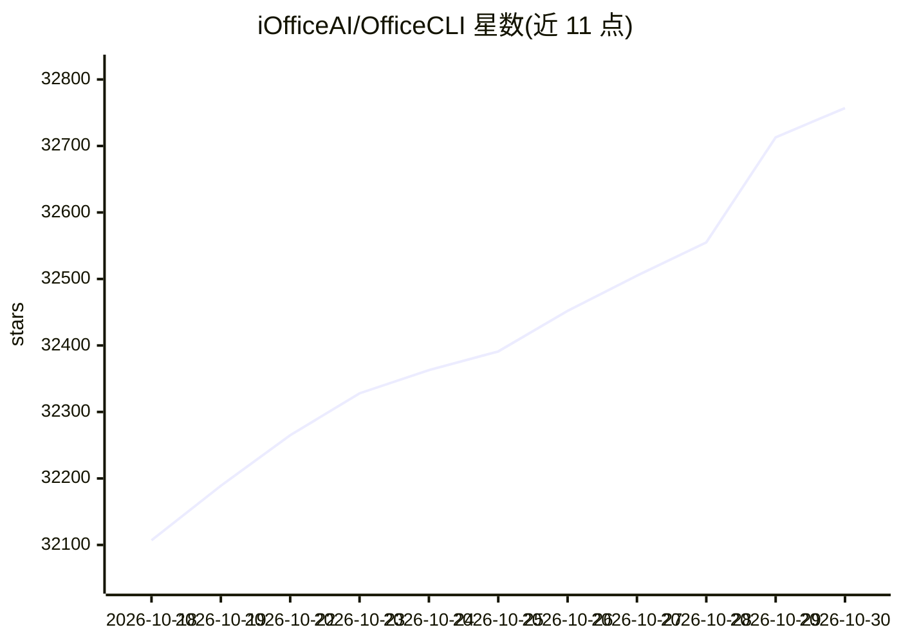

# iOfficeAI/OfficeCLI

⭐ 32,757 · C# · Apache-2.0 · 推送 2026-10-28 · [GitHub](https://github.com/iOfficeAI/OfficeCLI) · [官网](https://officecli.ai) · 组织维护 · 中文 README

**让 AI Agent 读写并自动化 Word/Excel/PPT 的 CLI 套件**

以单一二进制分发的命令行工具，供 AI Agent 创建、读取、修改与自动化 .docx/.xlsx/.pptx 文件，运行无需安装 Office。内置 HTML 渲染引擎可将文档渲染为 HTML 或逐页 PNG，供多模态 Agent 执行渲染-检查-修正循环；Excel 写入时自动求值 350+ 内置函数。officecli install 会将 skill 文件装入检测到的 AI 编码 Agent。自述以 skill 文件引导 Agent 一行命令完成安装。

## 筛选速览

| 维度 | 判定 | 备注 |
|---|---|---|
| AI 角色 | `ai-native` | 本体是模型或模型工具 |
| 许可风险 | `permissive` | Apache-2.0 |
| 部署形态 | `desktop` | 安装包/桌面程序 |
| 模型依赖 | — | README 未给出锁定关系 |
| 硬件要求 | — | 无带数字的原话,不猜 |
| 安装摩擦 | `medium` | 含编译或系统依赖之一 |
| 成熟度 | `idea` | |

## 动量与使用信号

- 维护:`active` — 距上次 push 5.2 天,年发版 100,20 位贡献者
- 涨星:近 1 天 **+45**(自 20261016 起算)
- 安装:npm 包 `@officecli/officecli` 月下载 57,015
- 平台:WINDOWS / MACOS / LINUX · 协议:MCP

## 能力要点

- 单二进制内嵌 .NET 运行时，无需安装 Office 或管理依赖
- 内置渲染引擎：view html / view screenshot / watch 三种模式，支持 PNG 截图供多模态 Agent 读取
- Word/Excel/PPT 三类格式的读取、修改、创建能力矩阵
- Excel 公式引擎：350+ 函数写入时自动求值，含动态数组与财务统计函数

## 适用场景

- 让 AI Agent 根据用户提示生成演示文稿
- 在 CI/CD 或无显示器的容器环境中做无头 Office 文档自动化
- 批量对文档做查找替换、样式更新等批处理
- 从文档中抽取结构化数据为 JSON

## 场景标签

`文档解析` · 领域:知识与检索

## 证据(README 行号)

> L3: > **OfficeCLI is the world's first and the best Office suite designed for AI agents.**
> L68: This copies the binary to your PATH and installs the **officecli skill** into every AI coding agent it detects — Cl

## 星数曲线

2026-10-18 32,107 → 2026-10-30 32,757（+650）

---
*卡片 v1 · prompt 1.4 · 生成 2026-10-18 · 置信度 mid · 依据 README sha `7ac9e96a3d8d` · [字段定义](../../DATASET.md)*
