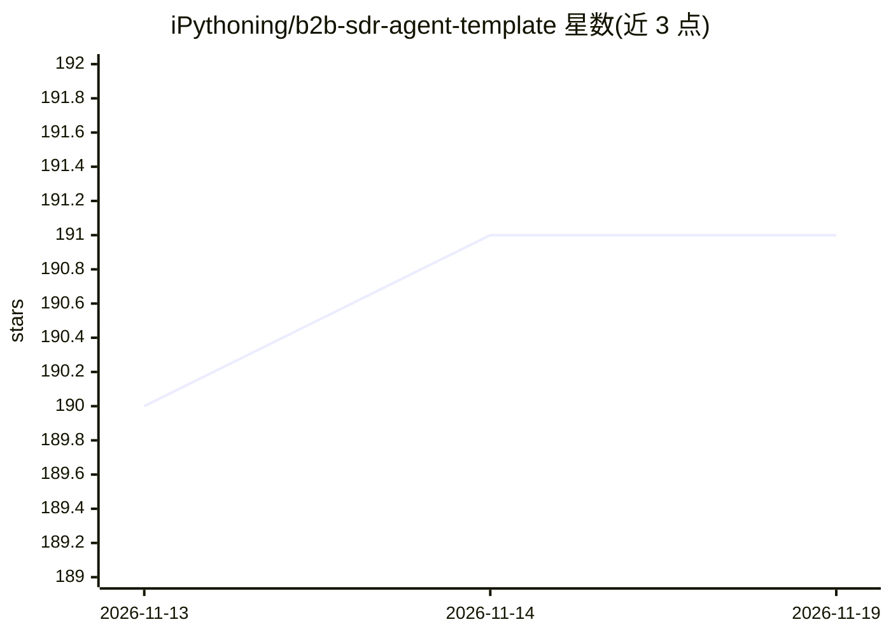

# iPythoning/b2b-sdr-agent-template

⭐ 191 · Shell · MIT · 推送 2026-09-29 · [GitHub](https://github.com/iPythoning/b2b-sdr-agent-template) · [官网](https://pulseagent.io) · 个人维护 · 中文 README

**面向 B2B 外贸企业的开源 AI 销售代表（SDR）部署模板**

基于 OpenClaw 构建的生产级 AI SDR 模板：通过 7 层 Markdown 上下文文件定制企业信息，覆盖 10 阶段销售流程（线索捕获、BANT 资格判定、报价、谈判、多渠道编排等）、14 项定时任务与 4 层防遗忘记忆架构（MemOS + 摘要压缩 + ChromaDB + CRM 快照）。支持 WhatsApp/Telegram/Email 多渠道，含 6 个预置技能与 4 档技能配置，提供控制面板与部署校验脚本。目标用户为 B2B 出口企业，需要已有 OpenClaw（或 Hermes Agent）运行环境，完整部署走 git clone + deploy 脚本上服务器。限制：README 声明对话中不表明 AI 身份、以销售人员身份呈现。

## 筛选速览

| 维度 | 判定 | 备注 |
|---|---|---|
| AI 角色 | `ai-ecosystem` | LLM/agent 周边工具 |
| 许可风险 | `permissive` | MIT |
| 部署形态 | `None` |  |
| 模型依赖 | — | README 未给出锁定关系 |
| 硬件要求 | — | 无带数字的原话,不猜 |
| 安装摩擦 | `low` | 无编译、无系统依赖或容器化 |
| 成熟度 | — | 结构信号不足 |

## 能力要点

- 10 阶段销售流程自动化，覆盖 WhatsApp/Telegram/Email 多渠道
- 4 层防遗忘记忆：MemOS 结构化记忆 + 摘要压缩 + ChromaDB + CRM 每日快照
- 7 层 Markdown 上下文系统（IDENTITY/SOUL/AGENTS 等）按业务定制
- 含部署校验（npm test）、doctor.sh 健康检查与 Web 控制面板

## 适用场景

- 外贸出口企业部署 AI 销售，自动接待与跟进 WhatsApp/Telegram 询盘
- 自动化报价（PDF 形式发票）、BANT 资格判定与线索评分
- 定时生成销售管道报告与滞留线索提醒

## 场景标签

`工作流自动化` `聊天机器人` · 领域:效率与自动化

## 证据(README 行号)

> L21: An open-source, production-ready template for building AI Sales Development Representatives (SDRs) that handle the 
> L23: Built on OpenClaw, battle-tested with real B2B export companies.

## 星数曲线

2026-11-13 190 → 2026-11-19 191（+1）

---
*卡片 v1 · prompt 1.4 · 生成 2026-11-17 · 置信度 mid · 依据 README sha `042aa1b97a40` · [字段定义](../../DATASET.md)*
