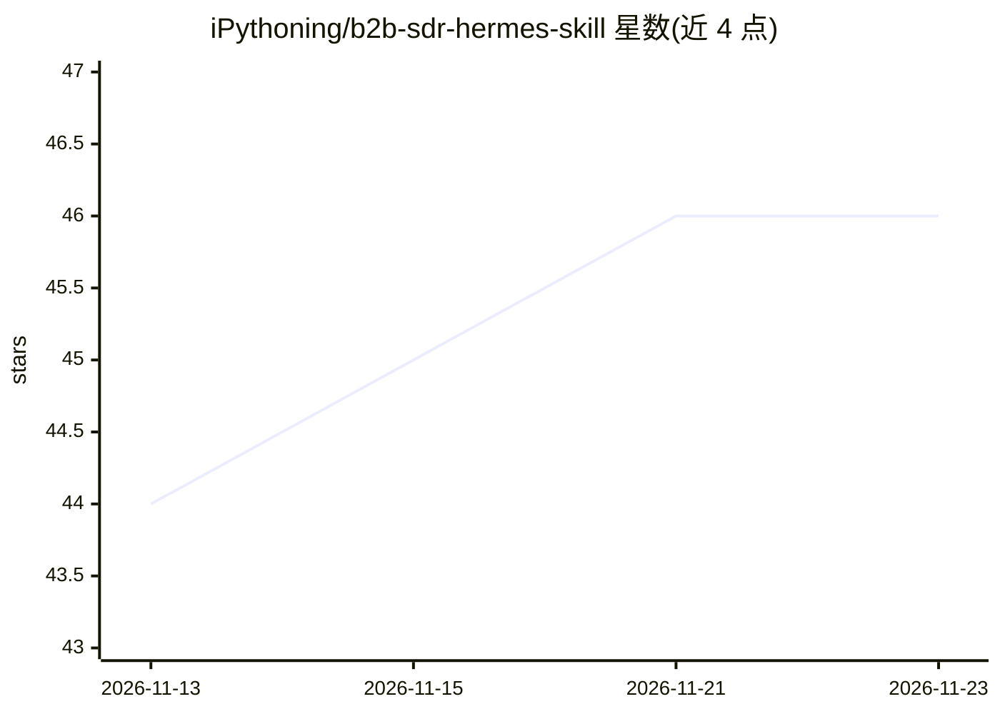

# iPythoning/b2b-sdr-hermes-skill

⭐ 46 · MIT · 推送 2026-08-20 · [GitHub](https://github.com/iPythoning/b2b-sdr-hermes-skill) · [官网](https://pulseagent.io) · 个人维护

**Hermes Agent 的 B2B 外贸 AI 销售 SDR 技能：找客户、跟单、发触达**

安装到 Hermes Agent 的自主销售开发代表（SDR）技能：通过网络搜索发现目标市场买家，经 WhatsApp/Email/Telegram 多渠道进行 BANT 资质评分、公司背景与决策人调研、带运输与付款条款的报价生成、4 触点冷邮件序列，并将线索记录到 Google Sheets/Notion/JSON/HubSpot 等 CRM；含 7 个预置 Cron 例行任务（线索检查、停滞告警、周报、重新激活）。要求 Hermes Agent v0.7.0+ 及已配对的 WhatsApp 通道、网络搜索与邮件配置。另提供 PulseAgent 托管版试用入口。

## 筛选速览

| 维度 | 判定 | 备注 |
|---|---|---|
| AI 角色 | `ai-native` | 本体是模型或模型工具 |
| 许可风险 | `permissive` | MIT |
| 部署形态 | `library` | 以包/库形式分发 |
| 模型依赖 | — | README 未给出锁定关系 |
| 硬件要求 | — | 无带数字的原话,不猜 |
| 安装摩擦 | `low` | 无编译、无系统依赖或容器化 |
| 成熟度 | — | 结构信号不足 |

## 能力要点

- 覆盖线索发现、BANT 评分、报价、外联序列与 CRM 管理的全流程 SDR 技能
- 7 个预置 Cron 例行任务（每 4 小时新线索检查、停滞告警、周报等）
- 4 种 CRM 选项：Google Sheets / JSON 文件 / Notion / HubSpot
- 支持从 OpenClaw 的 b2b-sdr-agent-template 迁移（SOUL.md/MEMORY.md/CRM 数据自动迁移）

## 适用场景

- 外贸 B2B 业务搭建 24/7 自动找客户并发送个性化触达的 AI 销售
- 通过 WhatsApp/Telegram 对话自动评分与筛选潜在买家
- 用定时任务自动跟进报价与停滞线索并生成管道周报

## 场景标签

`工作流自动化` · 领域:效率与自动化

## 证据(README 行号)

> L5: > Autonomous AI Sales Development Representative — finds buyers, qualifies leads, sends personalized outreach, and m
> L12: |Stage|Action|Channel|

## 星数曲线

2026-11-13 44 → 2026-11-23 46（+2）

---
*卡片 v1 · prompt 1.4 · 生成 2026-11-18 · 置信度 high · 依据 README sha `6860b62b6b7b` · [字段定义](../../DATASET.md)*
