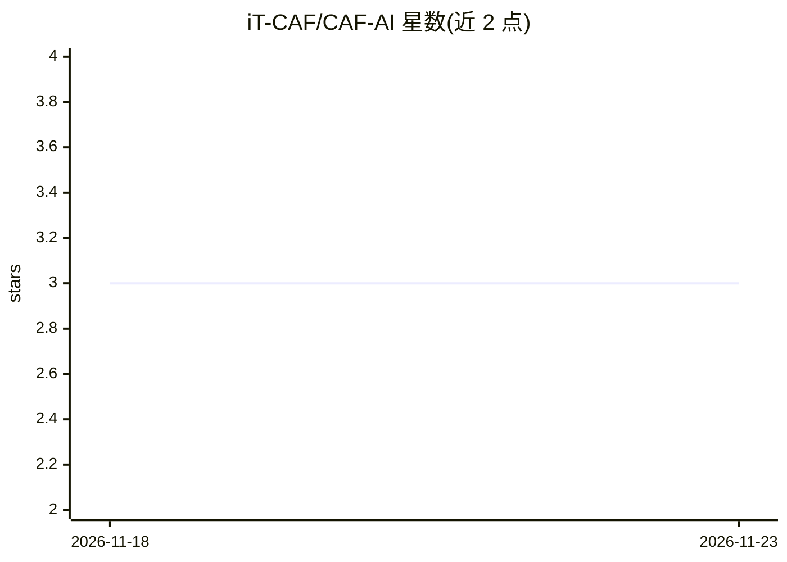

# iT-CAF/CAF-AI

⭐ 3 · JavaScript · NOASSERTION · 推送 2026-11-16 · [GitHub](https://github.com/iT-CAF/CAF-AI) · 组织维护

**本机离线运行的阿拉伯语优先全能 AI 助手（聊天/代码/图像/文档/语音）**

在用户自己的电脑上运行的一体化 AI 助手，功能覆盖聊天、实时画布写代码、图像理解与生成、PDF/Word/Excel/CSV 文档处理、语音输入输出与 28 个内置技能；默认仅监听 127.0.0.1，全部数据存于本机目录，可设 CAF_HOME 运行于 USB。通过 startcaf 命令安装与启动，首次运行时下载引擎与模型；按设备内存/显卡给出推荐模型清单。许可证为保留所有权利，个人与机构免费使用但禁止再分发与修改。

## 筛选速览

| 维度 | 判定 | 备注 |
|---|---|---|
| AI 角色 | `ai-native` | 本体是模型或模型工具 |
| 许可风险 | `none` | NOASSERTION |
| 部署形态 | `None` |  |
| 模型依赖 | local-ok | 支持本地模型 |
| 硬件要求 | — | 无带数字的原话,不猜 |
| 安装摩擦 | `medium` | 含编译或系统依赖之一 |
| 成熟度 | — | 结构信号不足 |

## 能力要点

- 离线运行，无账户、无云、无 CDN，数据全部存本机
- 本地 OpenAI 兼容 API（127.0.0.1 + 本地密钥）
- stable-diffusion.cpp 本地图像生成，whisper.cpp/gemma4 本地语音
- 按设备内存/显卡自动测量并推荐合适模型

## 适用场景

- 在无网络环境下使用聊天、编程与文档问答
- 以阿拉伯语为主要语言进行本地 AI 对话
- 把助手装进 USB 随身携带并在多台电脑运行
- 手机扫码在同一 Wi-Fi 内访问电脑上的助手

## 场景标签

`AI 助手` `图像生成` `文档问答` `语音 Agent` · 领域:对话与助手

## 证据(README 行号)

> L5: **مساعدك الذكي الشامل على جهازك: محادثة، برمجة بلوحة حيّة، فهم الصور وتوليدها، مستندات، صوت، ومهارات — بلا إنترنت ول
> L7: **Your all-in-one AI assistant on your own device: chat, live-canvas coding, image understanding & generation, docum
> L35: |🔌|**واجهة برمجية محلية متوافقة مع OpenAI:** على ‎127.0.0.1‎ بمفتاح محلي — الدليل.|

## 星数曲线

2026-11-18 3 → 2026-11-23 3（+0）

---
*卡片 v1 · prompt 1.4 · 生成 2026-11-21 · 置信度 high · 依据 README sha `a803d1f40671` · [字段定义](../../DATASET.md)*
