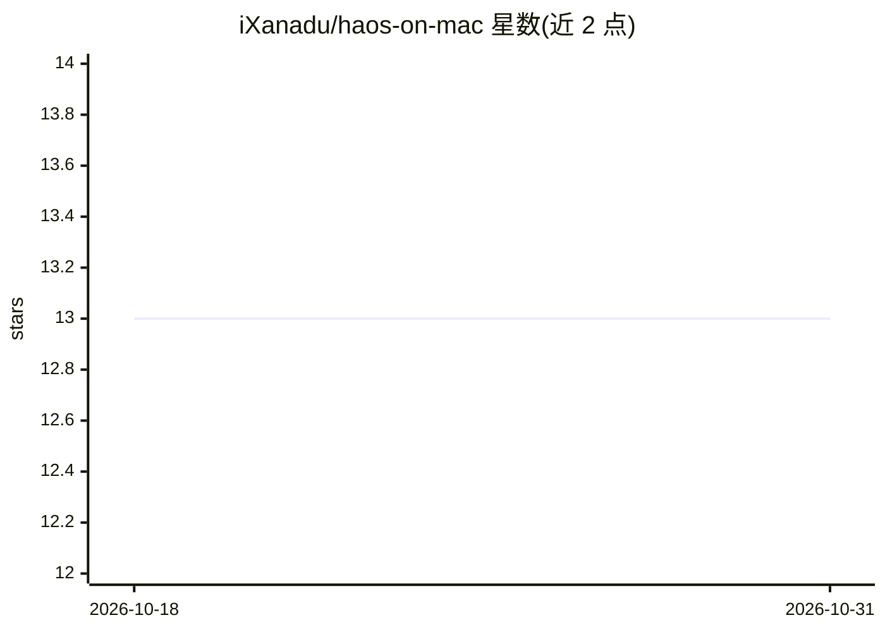

# iXanadu/haos-on-mac

⭐ 13 · MIT · 推送 2026-07-20 · [GitHub](https://github.com/iXanadu/haos-on-mac) · 个人维护

**在 Mac Mini 上部署 HAOS 与本地 Ollama 语音助手教程**

面向熟悉命令行用户的分阶段搭建指南：用 UTM/QEMU 虚拟机运行 Home Assistant OS（含 Supervisor 与应用商店），Ollama 在 macOS 原生运行以使用 Metal GPU 做本地 LLM 推理，配合 Whisper 语音识别与 Piper 语音合成组成离线语音管线，通过桥接网络互联，全程不依赖云服务。文中给出按统一内存（16/24/32GB）选择模型规模的对照表，并解释了放弃 Docker/Colima 方案的原因（内存占用高、无 Supervisor、网络问题）。各阶段为检查点，可随时停用。

## 筛选速览

| 维度 | 判定 | 备注 |
|---|---|---|
| AI 角色 | `ai-knowledge` | 知识聚合/清单类 |
| 许可风险 | `permissive` | MIT |
| 部署形态 | `desktop` | 安装包/桌面程序 |
| 模型依赖 | local-ok | 支持本地模型 |
| 硬件要求 | — | 无带数字的原话,不猜 |
| 安装摩擦 | `low` | 无编译、无系统依赖或容器化 |
| 成熟度 | — | 结构信号不足 |

## 能力要点

- HAOS 运行于 UTM/QEMU 虚拟机（4GB 内存分配，需 QEMU 后端）
- Ollama 原生运行于 Metal GPU，HAOS 通过桥接网络接入
- 语音管线：Whisper 语音转文本 + 本地 LLM + Piper 文本转语音
- 按统一内存分档的模型选择对照表（16GB→7-8B，32GB→30B+）

## 适用场景

- 把 Mac Mini 变成本地化的智能家居语音助手主机
- 不依赖云服务搭建带 LLM 对话能力的 Home Assistant
- 选择适合自己内存配置的本地对话模型

## 场景标签

`教程课程` `语音 Agent` · 领域:对话与助手

## 证据(README 行号)

> L3: Run Home Assistant OS on a Mac Mini with a local voice assistant powered by Ollama. No cloud, no subscriptions, no d
> L5: This guide walks you from a clean Mac to a fully working voice-controlled home assistant with:
> L12: Each section is a checkpoint — you can stop at any tier and have something working.

## 星数曲线

2026-10-18 13 → 2026-10-31 13（+0）

---
*卡片 v1 · prompt 1.4 · 生成 2026-10-31 · 置信度 mid · 依据 README sha `15b27d1090cf` · [字段定义](../../DATASET.md)*
