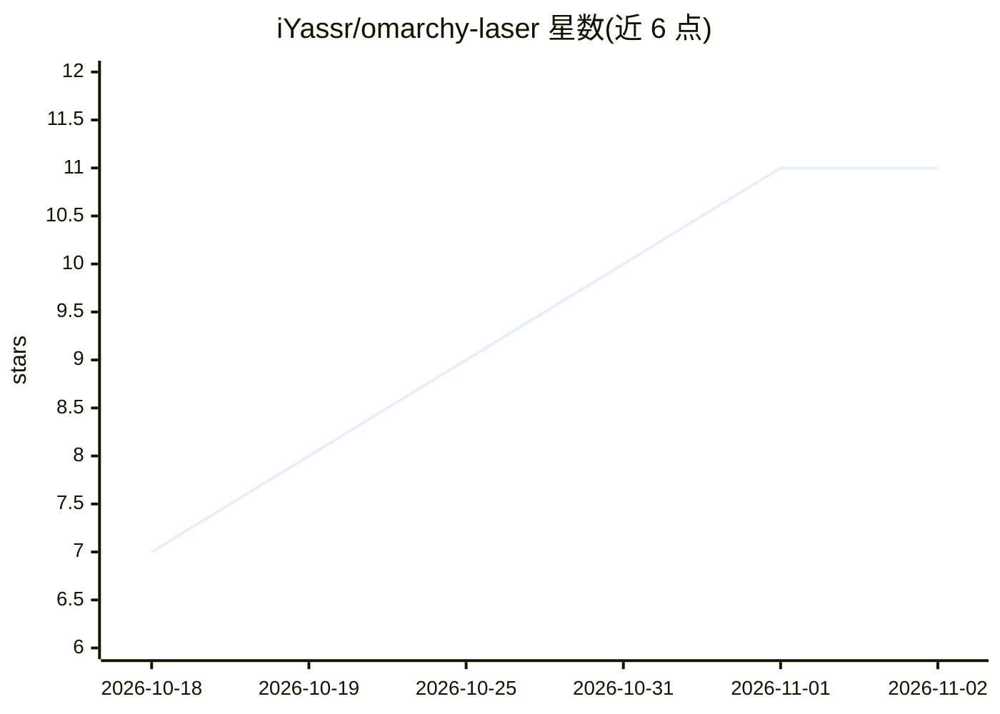

# iYassr/omarchy-laser

⭐ 11 · Python · MIT · 推送 2026-10-08 · [GitHub](https://github.com/iYassr/omarchy-laser) · [官网](https://github.com/iYassr/omarchy-laser#readme) · 个人维护

**Omarchy/Hyprland 上的 AI 专注模式与防分心插件**

面向 Linux Omarchy/Hyprland 桌面用户的专注辅助插件：声明当前任务后，它通过 hyprctl 监视活动窗口，将屏幕内容（三档隐私级别）经本机 OCR 后送 TypeSafe Jev 分类模型判定是否偏离任务，并按 30 秒到 4 分钟的梯度逐级提醒（红点→通知→红边→窗口模糊→关闭浏览器标签页）。仅使用 Python 标准库，截图不离开本机，仅连接 api.typesafe.ai，费用自带 API key，约每月 $0.30–0.50。无 OCR 依赖时仅按站点名称判定。

## 筛选速览

| 维度 | 判定 | 备注 |
|---|---|---|
| AI 角色 | `ai-enhanced` | 去掉 AI 部分产品仍成立 |
| 许可风险 | `permissive` | MIT |
| 部署形态 | `None` |  |
| 模型依赖 | — | README 未给出锁定关系 |
| 硬件要求 | — | 无带数字的原话,不猜 |
| 安装摩擦 | `low` | 无编译、无系统依赖或容器化 |
| 成熟度 | — | 结构信号不足 |

## 能力要点

- 按用户声明的任务逐屏判定，而非静态屏蔽名单
- 30 秒→4 分钟的梯度升级干预，仅关闭浏览器标签不关原生应用
- 截图仅本机 OCR 不上传，聊天/邮件/银行/密码管理器站点永不读屏
- 纯 Python 标准库实现，~55 MB 内存，`laser audit` 可审计发送内容

## 适用场景

- 我在写论文或做深度工作时防止刷 Reddit/YouTube 跑偏
- 同一站点（如 WhatsApp）按当次任务判断是工作还是分心
- ADHD 用户需要不依赖意志力的外部提醒机制

## 场景标签

 · 领域:桌面效率/专注工具

## 证据(README 行号)

> L7: An AI distraction blocker for Omarchy and Hyprland on Linux. It judges
> L29: a second and costs a fraction of a cent, through TypeSafe's Jev, a fast

## 星数曲线

2026-10-18 7 → 2026-11-02 11（+4）

---
*卡片 v1 · prompt 1.4 · 生成 2026-11-02 · 置信度 high · 依据 README sha `9aa8cf15fb80` · [字段定义](../../DATASET.md)*
