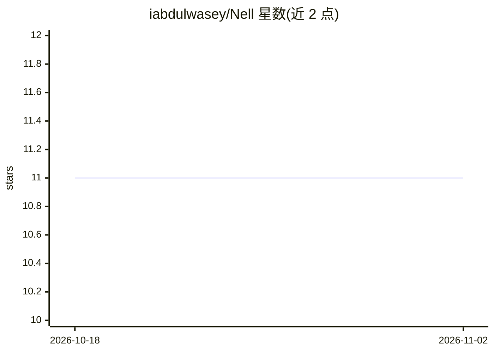

# iabdulwasey/Nell

⭐ 11 · TypeScript · NOASSERTION · 推送 2026-09-01 · [GitHub](https://github.com/iabdulwasey/Nell) · 个人维护

**可自托管的个人 AI 代理：用消息驱动浏览器代办事务**

个人 AI agent，用户通过 Telegram、WhatsApp、iMessage 发消息下达任务，Nell 驱动真实浏览器完成订位、购票、监控提醒等操作。安全机制包括：密钥 AES-256-GCM 加密存储且不暴露给模型、消费/发消息/用凭据须经代码层审批、单用途限额虚拟卡、仅追加哈希链审计日志。模型自选（Anthropic/OpenAI/DeepSeek/GLM 等）。限制：单机单任务，durable execution 未接入运行时；部分功能已测试但尚不可从聊天触达。

## 筛选速览

| 维度 | 判定 | 备注 |
|---|---|---|
| AI 角色 | `ai-native` | 本体是模型或模型工具 |
| 许可风险 | `none` | NOASSERTION |
| 部署形态 | `self-host` | docker 或自建部署 |
| 模型依赖 | — | README 未给出锁定关系 |
| 硬件要求 | — | 无带数字的原话,不猜 |
| 安装摩擦 | `low` | 无编译、无系统依赖或容器化 |
| 成熟度 | `idea` | |

## 能力要点

- 驱动真实浏览器完成订票、订位等任务，消费动作经代码层审批门控
- 凭据保险库 AES-256-GCM 加密，密钥不暴露给模型
- 51 个对抗攻击测试与 1,318 个测试在每次提交运行
- 支持 Telegram、WhatsApp、iMessage 通道与多模型接入

## 适用场景

- 通过消息让 AI 代为预订餐厅、购买门票并经我确认支付
- 设置后台监控并在有变化时收到通知
- 自托管管理个人账户、密码与偏好记忆

## 场景标签

`浏览器自动化` `AI 助手` · 领域:效率与自动化

## 证据(README 行号)

> L3: **Open Source Instinct — a personal AI agent you text to get things done.**
> L21: Under the hood Nell drives a real browser, remembers what you like, runs
> L15: > **You:** book me a sushi place Friday for 4

## 星数曲线

2026-10-18 11 → 2026-11-02 11（+0）

---
*卡片 v1 · prompt 1.4 · 生成 2026-11-02 · 置信度 high · 依据 README sha `4a3ae818350e` · [字段定义](../../DATASET.md)*
