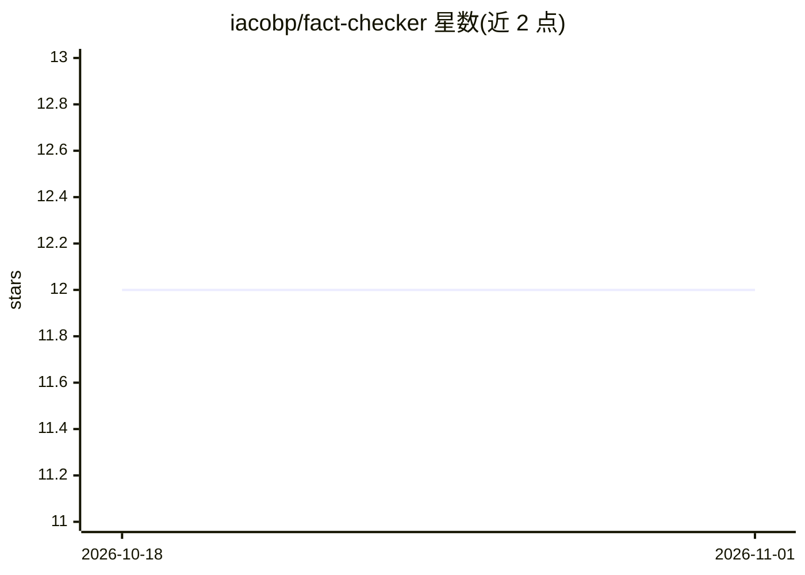

# iacobp/fact-checker

⭐ 12 · JavaScript · MIT · 推送 2026-07-16 · [GitHub](https://github.com/iacobp/fact-checker) · [官网](https://chromewebstore.google.com/detail/olfaipihfeomkedngnkkmappbojmlmml) · 个人维护

**Chrome 扩展：让 Perplexity Pro 用户在任意网页核查选中文本真伪**

面向 Perplexity Pro 订阅用户的 Chrome 浏览器扩展：选中文本后右键即可调用 Perplexity API 进行事实核查，弹窗展示真实度百分比、核查摘要、上下文语境与来源链接。默认使用 llama-3-8b-instruct 模型，消耗 Pro 用户每月 5 美元 API 额度，并给出节省 token 的使用建议。通过 Chrome 应用商店安装并填入 API key，开发环境可从源码加载。作者声明这是其首个 Chrome 扩展。

## 筛选速览

| 维度 | 判定 | 备注 |
|---|---|---|
| AI 角色 | `ai-native` | 本体是模型或模型工具 |
| 许可风险 | `permissive` | MIT |
| 部署形态 | `None` |  |
| 模型依赖 | — | README 未给出锁定关系 |
| 硬件要求 | — | 无带数字的原话,不猜 |
| 安装摩擦 | `low` | 无编译、无系统依赖或容器化 |
| 成熟度 | — | 结构信号不足 |

## 能力要点

- 选中文本右键即可核查，弹窗返回真实度百分比、摘要与来源
- 调用 Perplexity API，默认使用 llama-3-8b-instruct 模型
- 说明 $5/月 API 额度机制与 token 节省建议
- JavaScript/HTML/CSS 构建，可从源码以开发者模式加载

## 适用场景

- 阅读网页时快速核查可疑陈述的真实性
- 获取陈述的核查摘要与参考来源
- 在不离开当前页面的情况下验证信息

## 场景标签

`AI 助手` · 领域:对话与助手

## 证据(README 行号)

> L5: This Chrome extension allows Perplexity Pro users to fact-check any text on the web using Perplexity's API. It provi
> L9: - 🔍 Fact-check any selected text on any webpage
> L10: - 📊 Get a truth percentage for the selected statement

## 星数曲线

2026-10-18 12 → 2026-11-01 12（+0）

---
*卡片 v1 · prompt 1.4 · 生成 2026-11-01 · 置信度 high · 依据 README sha `6727386336f1` · [字段定义](../../DATASET.md)*
