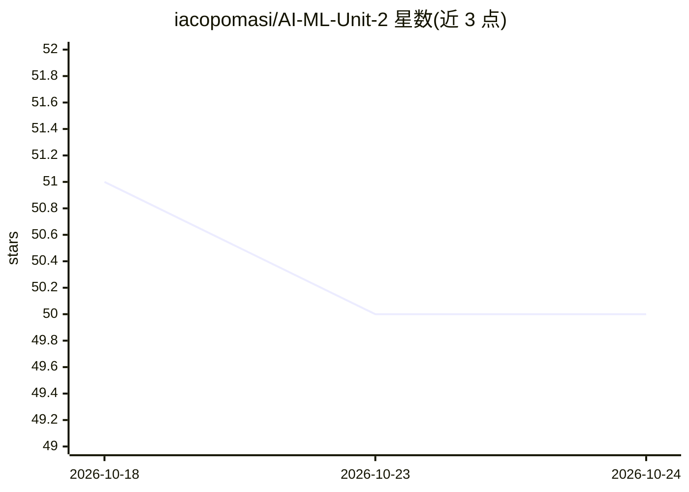

# iacopomasi/AI-ML-Unit-2

⭐ 50 · Jupyter Notebook · 推送 2026-03-26 · [GitHub](https://github.com/iacopomasi/AI-ML-Unit-2) · 组织维护

**罗马一大 AI 与机器学习课程资料库（Unit 2）**

Sapienza 大学计算机系 Applied Computer Science and Artificial Intelligence 本科二年级课程的第二单元教学材料仓库，主题为机器学习入门：涵盖监督/非监督学习、参数/非参数方法等学习模态，涉及线性代数、微积分、概率统计等数学基础，课程以理论为主并配合小型数据集上的实践实现（有时从零实现基础算法），会适当引入部分深度学习基础概念并连接近期 AI/ML 论文。授课语言为英语。

## 筛选速览

| 维度 | 判定 | 备注 |
|---|---|---|
| AI 角色 | `ai-knowledge` | 知识聚合/清单类 |
| 许可风险 | `none` | — |
| 部署形态 | `None` |  |
| 模型依赖 | — | README 未给出锁定关系 |
| 硬件要求 | — | 无带数字的原话,不猜 |
| 安装摩擦 | `low` | 无编译、无系统依赖或容器化 |
| 成熟度 | — | 结构信号不足 |

## 能力要点

- 覆盖监督/非监督、参数/非参数等主要学习模态
- 理论课配合玩具数据集实践，含从零实现基础算法
- 引入基本深度学习概念并连接近期研究论文
- 列出先修要求：线性代数、微积分、概率、统计

## 适用场景

- 本科阶段学习机器学习入门理论与数学基础
- 查找配合实践实现的教学材料
- 作为后续深度学习课程的先修准备

## 场景标签

`教程课程` · 领域:学习与行业

## 证据(README 行号)

> L2: Course Material for Artificial Intelligence and Machine Learning - Unit 2 @ Computer Science Dept, Sapienza
> L11: **Description:** The course is meant to introduce machine learning, a class of methods that learn patterns from dat

## 星数曲线

2026-10-18 51 → 2026-10-24 50（-1）

---
*卡片 v1 · prompt 1.4 · 生成 2026-10-24 · 置信度 high · 依据 README sha `33af6ef517a5` · [字段定义](../../DATASET.md)*
