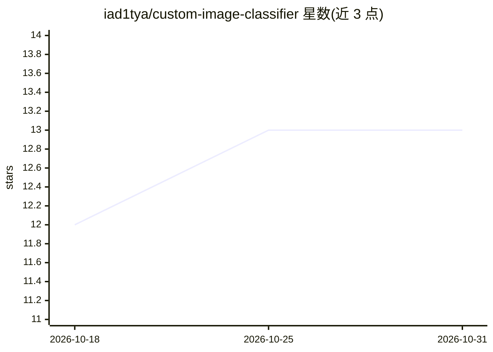

# iad1tya/custom-image-classifier

⭐ 13 · HTML · MIT · 推送 2025-11-26 · [GitHub](https://github.com/iad1tya/custom-image-classifier) · 个人维护

**通过 Web 界面免代码训练自定义图像分类模型**

基于 Flask + PyTorch + OpenCV 的图像分类训练框架：用户按类别文件夹组织图片打包上传，通过 Web 界面、CLI 或 REST API 触发训练与预测，支持任意类别数、自动数据增强与验证、训练实时监控、模型检查点与版本管理、CUDA 加速。模型为自定的 3 层卷积 CNN（含池化、批归一化、50% dropout），默认输入 128x128。面向需要快速 ML 原型的学生、研究者与开发者，通过 git clone 源码运行。

## 筛选速览

| 维度 | 判定 | 备注 |
|---|---|---|
| AI 角色 | `ai-native` | 本体是模型或模型工具 |
| 许可风险 | `permissive` | MIT |
| 部署形态 | `library` | 以包/库形式分发 |
| 模型依赖 | — | README 未给出锁定关系 |
| 硬件要求 | — | 无带数字的原话,不猜 |
| 安装摩擦 | `medium` | 含编译或系统依赖之一 |
| 成熟度 | — | 结构信号不足 |

## 能力要点

- Web UI / CLI / REST API 三种方式上传数据集并训练预测
- 任意类别数的自定义 CNN 训练，含自动增强与验证
- 实时训练监控、模型检查点与版本管理
- 可选 CUDA 加速（config.py 中 USE_CUDA）

## 适用场景

- 不会写代码也能上传图片集训练一个图像分类器
- 通过命令行或 API 把训练和预测接入自己的流程
- 同时管理多个分类项目并进行版本对比

## 场景标签

`模型训练` `目标检测` · 领域:感知与多模态

## 证据(README 行号)

> L10: **Train custom image classification models without writing code**
> L22: - Upload datasets and train models via web UI or CLI
> L92: **Stack:** Flask (backend) + PyTorch (ML) + OpenCV (vision)

## 星数曲线

2026-10-18 12 → 2026-10-31 13（+1）

---
*卡片 v1 · prompt 1.4 · 生成 2026-10-31 · 置信度 mid · 依据 README sha `1e0e9eba7777` · [字段定义](../../DATASET.md)*
