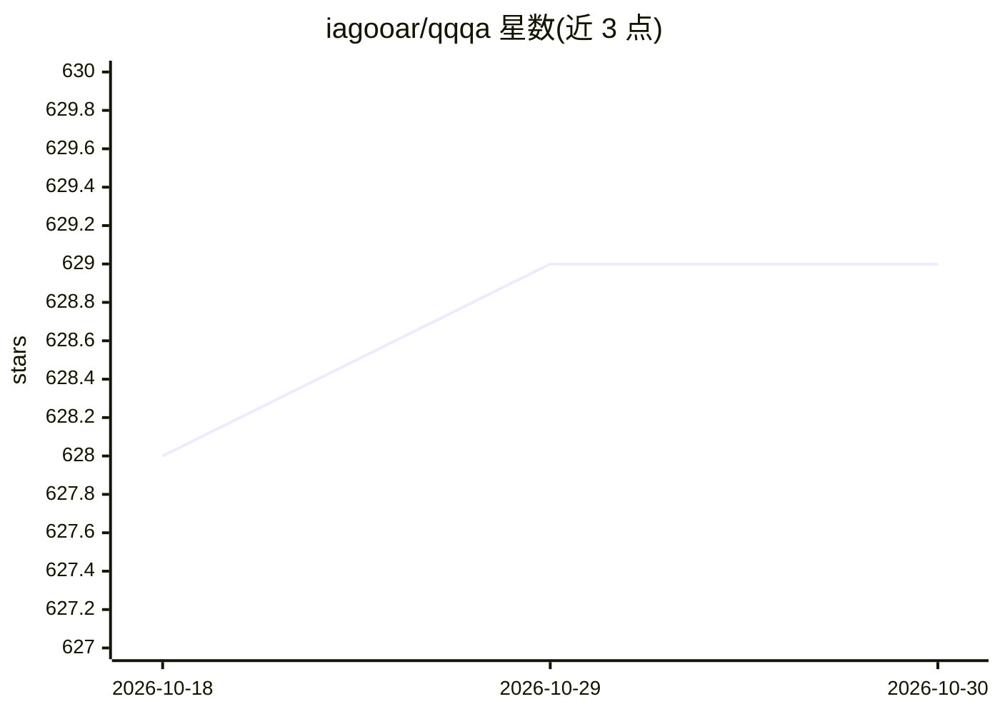

# iagooar/qqqa

⭐ 629 · Rust · MIT · 推送 2026-10-25 · [GitHub](https://github.com/iagooar/qqqa) · 个人维护

**无状态 shell LLM 助手：qq 问答，qa 执行命令**

Rust 编写的双命令行工具：qq 单次提问流式返回答案，qa 为单步 agent，可在确认后读文件、写文件或执行命令，带安全护栏。默认无会话无隐藏记忆，可用配置开启历史。内置 OpenRouter（默认）、OpenAI、Groq、Gemini（API 与 CLI）、本地 Ollama、Codex CLI、Claude Code CLI 等多档 provider/profile，通过 ~/.qq/config.json 配置，支持流式输出与管道组合。提供 Homebrew、Releases 预编译二进制与 cargo 安装方式。

## 筛选速览

| 维度 | 判定 | 备注 |
|---|---|---|
| AI 角色 | `ai-native` | 本体是模型或模型工具 |
| 许可风险 | `permissive` | MIT |
| 部署形态 | `desktop` | 安装包/桌面程序 |
| 模型依赖 | local-ok | 支持本地模型 |
| 硬件要求 | — | 无带数字的原话,不猜 |
| 安装摩擦 | `medium` | 含编译或系统依赖之一 |
| 成熟度 | — | 结构信号不足 |

## 能力要点

- qq 只读问答、qa 单步 agent 带工具确认的安全护栏
- 多 provider/profile 配置，支持 OpenAI 兼容 API 与 CLI 包装（Codex/Claude Code）
- 无状态设计，可通过管道与脚本组合
- 支持流式输出、终端历史（默认关闭）与自动复制首条命令

## 适用场景

- 在终端里快速向 LLM 提问并直接使用答案
- 让单步 agent 在确认后读写文件或执行命令
- 复用已有 ChatGPT/Claude 订阅而非另付 API 费用

## 场景标签

`AI 助手` · 领域:对话与助手

## 证据(README 行号)

> L7: qqqa is a two-in-one, stateless CLI tool that brings LLM assistance to the command line without ceremony.
> L11: - `qq` - ask a single question, e.g. "qq how can I recursively list all files in this directory" (qq stands for "qu
> L12: - `qa` - a single step agent that can optionally use tools to finish a task: read a file, write a file, or execute 

## 星数曲线

2026-10-18 628 → 2026-10-30 629（+1）

---
*卡片 v1 · prompt 1.4 · 生成 2026-10-21 · 置信度 mid · 依据 README sha `8c928e4a122f` · [字段定义](../../DATASET.md)*
