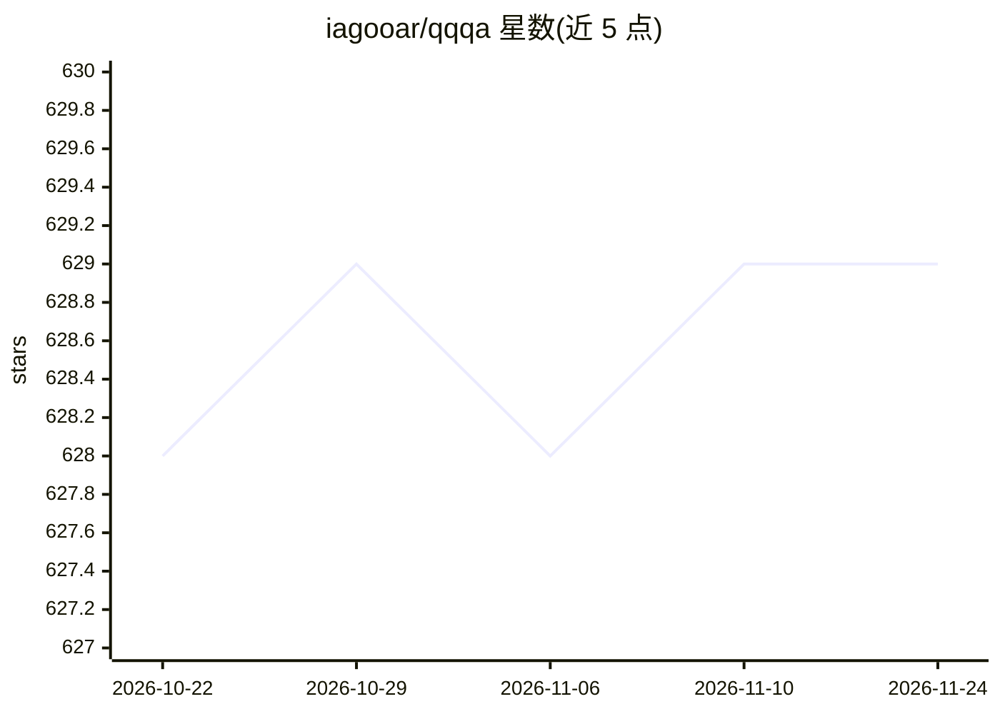

# iagooar/qqqa

⭐ 629 · Rust · MIT · 推送 2026-10-25 · [GitHub](https://github.com/iagooar/qqqa) · 个人维护

**给 shell 用户的轻量 LLM 命令行助手：qq 答问、qa 执行命令**

无状态的两合一 CLI 工具，包含两个二进制：qq 回答单个问题，qa 是单步 agent，可读文件、写文件或经确认执行一条命令。默认走 OpenRouter，内置 OpenAI、Groq、Gemini、本地 Ollama 等 profile，也可包装 Codex CLI / Claude Code CLI 以复用已有订阅。qq 只读且无工具权限，qa 每次调用工具需确认。通过 Homebrew 或 GitHub Releases 分发，支持 macOS、Linux、Windows，作者声明功能已完成、不再加新特性。

## 筛选速览

| 维度 | 判定 | 备注 |
|---|---|---|
| AI 角色 | `ai-native` | 本体是模型或模型工具 |
| 许可风险 | `permissive` | MIT |
| 部署形态 | `desktop` | 安装包/桌面程序 |
| 模型依赖 | local-ok | 支持本地模型 |
| 硬件要求 | — | 无带数字的原话,不猜 |
| 安装摩擦 | `medium` | 含编译或系统依赖之一 |
| 成熟度 | — | 结构信号不足 |

## 能力要点

- qq 问答 / qa 单步 agent（读文件、写文件、带确认执行命令）
- 默认 OpenRouter profile，支持任意 OpenAI 兼容 provider 自定义 profile
- 可包装 Codex CLI 与 Claude Code CLI 复用已有订阅，无需额外 API key
- 无状态设计，配合管道与脚本使用；qq 只读，qa 工具调用需确认

## 适用场景

- 在终端里快速查询忘记的 shell 命令写法
- 让 qa 一步完成读改文件或执行命令的小任务
- 把 LLM 响应组合进管道和脚本工作流
- 用本地 Ollama 模型离线跑问答

## 场景标签

`AI 助手` · 领域:对话与助手

## 证据(README 行号)

> L3: Fast, stateless LLM-powered assistant for your shell: qq answers; qa runs commands
> L20: - `qa` - a single step agent that can optionally use tools to finish a task: read a file, write a file, or execute 
> L95: - OpenAI compatible API client with streaming and non streaming calls.

## 星数曲线

2026-10-22 628 → 2026-11-24 629（+1）

---
*卡片 v1 · prompt 1.4 · 生成 2026-11-24 · 置信度 mid · 依据 README sha `df789df2868e` · [字段定义](../../DATASET.md)*
