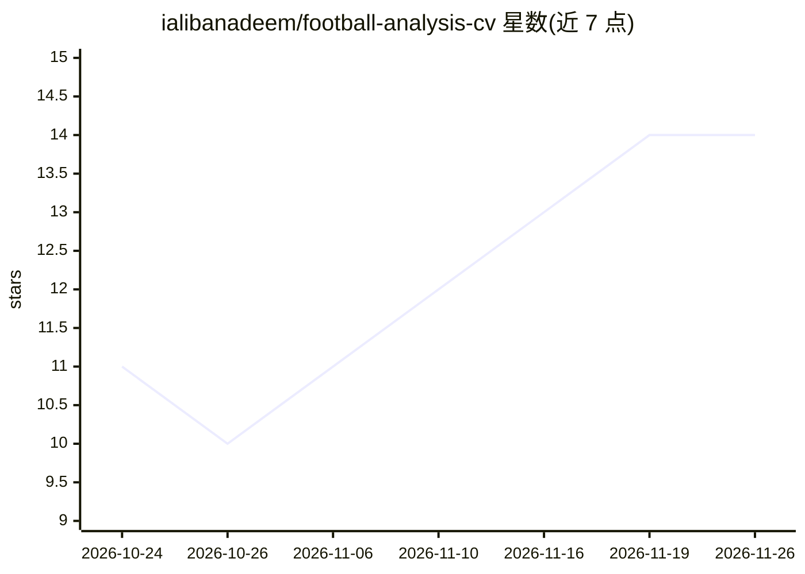

# ialibanadeem/football-analysis-cv

⭐ 14 · Python · 推送 2026-07-22 · [GitHub](https://github.com/ialibanadeem/football-analysis-cv) · 个人维护

**足球比赛视频分析管线：跟踪球员并计算速度/控球**

端到端计算机视觉管线，对转播足球视频中的球员、裁判和足球进行检测与跟踪，结合 ByteTrack 多目标跟踪、K-Means 队服颜色聚类分队、Lucas-Kanade 光流相机补偿和单应性透视变换，将 2D 像素映射到真实球场坐标，输出球员速度、跑动距离与球队控球统计并叠加到输出视频。内置 metrics/ 评估模块，对 9 个组件计算 mAP、IDF1、MOTA 等指标并生成 JPG 图表。需 Python 3.10+，用户需自备训练好的模型权重 best.pt 与输入视频。

## 筛选速览

| 维度 | 判定 | 备注 |
|---|---|---|
| AI 角色 | `ai-native` | 本体是模型或模型工具 |
| 许可风险 | `permissive` | — |
| 部署形态 | `library` | 以包/库形式分发 |
| 模型依赖 | — | README 未给出锁定关系 |
| 硬件要求 | — | 无带数字的原话,不猜 |
| 安装摩擦 | `low` | 无编译、无系统依赖或容器化 |
| 成熟度 | — | 结构信号不足 |

## 能力要点

- YOLOv8 微调模型检测球员/裁判/足球，ByteTrack 跨遮挡持续跟踪
- K-Means 队服聚类自动分队，无需人工标注
- 光流相机补偿 + 单应性变换映射到球场坐标，计算速度/距离/控球
- metrics/ 模块对 9 个组件输出量化指标与 JPG 报表

## 适用场景

- 分析比赛转播视频中的球员速度与跑动距离
- 统计球队控球率并叠加到输出视频
- 对检测/跟踪/测速各环节做量化评估

## 场景标签

`目标检测` · 领域:感知与多模态

## 证据(README 行号)

> L9: An end-to-end Computer Vision and Spatial Data Analytics pipeline that detects, tracks, and analyzes football player
> L11: By combining **deep learning object detection (YOLOv8)**, **multi-object tracking (ByteTrack)**, **K-Means jersey c

## 星数曲线

2026-10-24 11 → 2026-11-26 14（+3）

---
*卡片 v1 · prompt 1.4 · 生成 2026-11-18 · 置信度 high · 依据 README sha `9878d6d7a646` · [字段定义](../../DATASET.md)*
