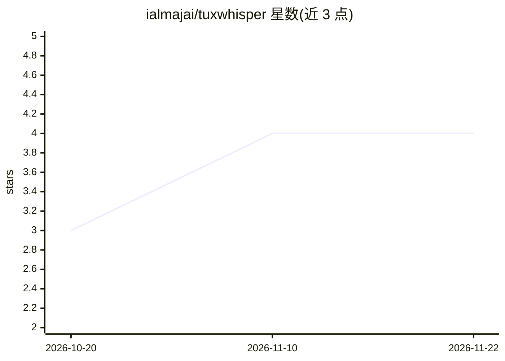

# ialmajai/tuxwhisper

⭐ — · [GitHub]() · 个人维护

**Linux 离线按键说话语音听写工具，输入到任意应用**

面向 Linux 桌面的本地离线听写工具：按键说话，松开后约半秒将转录文本粘贴到光标处，支持 X11 与 Wayland（含 GNOME）下的浏览器、编辑器、终端等任意文本输入位置。转录用 faster-whisper 在本地运行，支持 NVIDIA GPU（CUDA）、AMD/Intel GPU（Vulkan）或 CPU。可选清理键调用本地 Ollama 模型（默认 Llama 3.2）去除语气词、修正标点、改写为邮件或要点，并应用口头自我更正。提供自定义词汇、替换规则、录音保存用于微调等功能。安装需 systemd 与 uv。

## 筛选速览

| 维度 | 判定 | 备注 |
|---|---|---|
| AI 角色 | `ai-native` | 本体是模型或模型工具 |
| 许可风险 | `permissive` | — |
| 部署形态 | `library` | 以包/库形式分发 |
| 模型依赖 | local-ok | 支持本地模型 |
| 硬件要求 | — | 无带数字的原话,不猜 |
| 安装摩擦 | `medium` | 含编译或系统依赖之一 |
| 成熟度 | — | 结构信号不足 |

## 能力要点

- faster-whisper 本地转录，NVIDIA/AMD/Intel GPU 或 CPU 运行
- X11 与 Wayland（含 GNOME）下可输入到任意应用
- 可选清理键经本地 Ollama 模型去除语气词、改写文体
- 保存录音用于针对个人声音微调 Whisper

## 适用场景

- 在 Linux 上离线口述文字到浏览器或编辑器
- 不希望语音数据上传云服务的听写场景
- 用 LLM 清理键把口述整理成邮件或要点

## 场景标签

`语音识别` · 领域:感知与多模态

## 证据(README 行号)

> L3: **Private, offline dictation for Linux.** Press a key, speak, and your words are typed
> L5: terminal. Everything runs on your own machine with free, open models. Your voice never
> L22: - **Fast:** OpenAI's open Whisper model (faster-whisper)
> L27: - **LLM cleanup (optional):** the cleanup key runs your words through a local Ollama

## 星数曲线

2026-10-20 3 → 2026-11-22 4（+1）

---
*卡片 v1 · prompt 1.4 · 生成 2026-11-21 · 置信度 high · 依据 README sha `f41431e478ad` · [字段定义](../../DATASET.md)*
