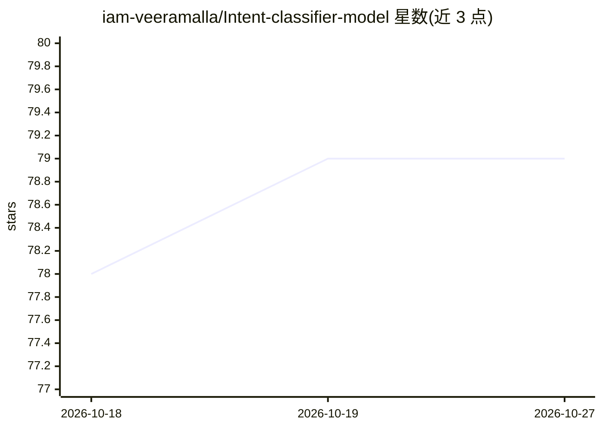

# iam-veeramalla/Intent-classifier-model

⭐ — · [GitHub]() · 个人维护

**客服短文本意图分类小模型：五分类并经 Flask API 提供**

面向短客服类文本的微型意图分类器项目：训练脚本生成 pickle 模型工件，Flask 应用暴露 /predict 接口，输入文本返回 greeting/question/complaint/praise/other 五类意图及各类概率。README 给出完整本地流程：创建虚拟环境并 pip 安装依赖、运行训练脚本、启动 API 服务并用 curl 示例请求。项目定位为 MLOps 演示（训练-保存-服务），未见预训练权重分发与部署文档。

## 筛选速览

| 维度 | 判定 | 备注 |
|---|---|---|
| AI 角色 | `ai-native` | 本体是模型或模型工具 |
| 许可风险 | `none` | — |
| 部署形态 | `library` | 以包/库形式分发 |
| 模型依赖 | — | README 未给出锁定关系 |
| 硬件要求 | — | 无带数字的原话,不猜 |
| 安装摩擦 | `low` | 无编译、无系统依赖或容器化 |
| 成熟度 | — | 结构信号不足 |

## 能力要点

- 五类意图分类（greeting/question/complaint/praise/other）
- Flask API /predict 端点返回意图与各类概率
- 训练脚本生成 pickle 模型工件

## 适用场景

- 客服消息做初步意图归类
- 学习训练-保存-服务的小型 MLOps 流程

## 场景标签

`MLOps` · 领域:训练与推理

## 证据(README 行号)

> L3: This small project demonstrates:
> L4: - Training a tiny text classifier.
> L6: - Serving predictions via a Flask API (`/predict`).

## 星数曲线

2026-10-18 78 → 2026-10-27 79（+1）

---
*卡片 v1 · prompt 1.4 · 生成 2026-10-24 · 置信度 mid · 依据 README sha `2b434f374856` · [字段定义](../../DATASET.md)*
