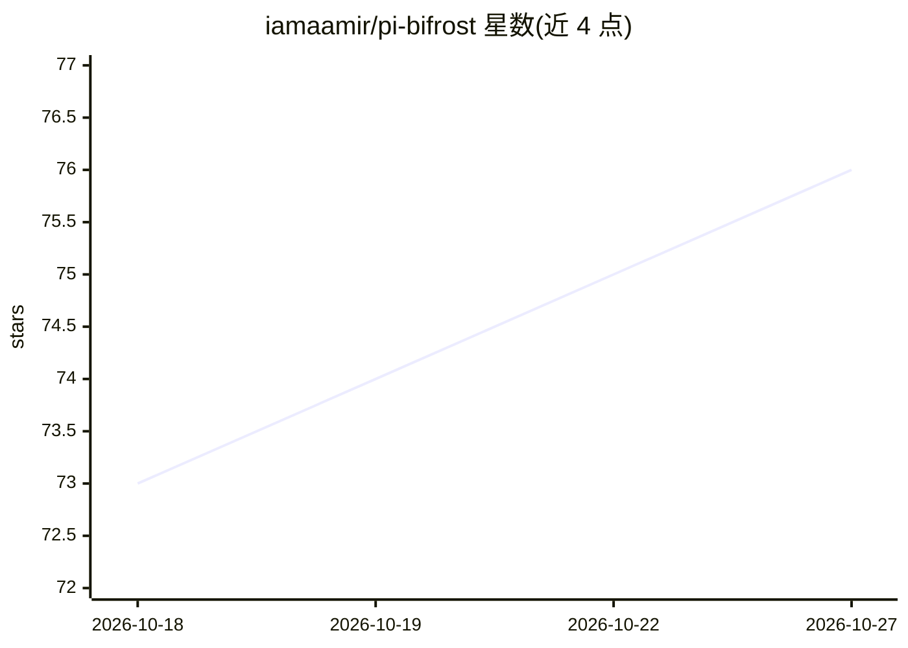

# iamaamir/pi-bifrost

⭐ 76 · TypeScript · MIT · 推送 2026-10-26 · [GitHub](https://github.com/iamaamir/pi-bifrost) · [官网](https://iamaamir.github.io/pi-bifrost/) · 个人维护

**Pi 编码助手的模型路由扩展：按层级为每轮对话选择模型**

面向 Pi 的模型路由扩展：用户将模型组成命名层级（tier），按列表顺序、价格、上下文窗口、探测速度或随机等策略为每轮对话选择模型；可通过规则、消息前缀、本地分类缓存或可选分类器判定层级。内置可靠性熔断机制，跳过多次失败的模型，失败对话不会自动重发。支持物理选择（默认）与 opt-in 的 Bifrost Auto 两种模式，可通过 /bifrost pin 固定单一模型。需要 Pi 1.0.1 或更新版本，模型池默认为空、由用户自行配置。

## 筛选速览

| 维度 | 判定 | 备注 |
|---|---|---|
| AI 角色 | `ai-ecosystem` | LLM/agent 周边工具 |
| 许可风险 | `none` | MIT |
| 部署形态 | `None` |  |
| 模型依赖 | — | README 未给出锁定关系 |
| 硬件要求 | — | 无带数字的原话,不猜 |
| 安装摩擦 | `low` | 无编译、无系统依赖或容器化 |
| 成熟度 | — | 结构信号不足 |

## 能力要点

- 命名层级（quick/general/frontier）与多种选择策略（列表/价格/上下文/速度/随机）
- 可靠性熔断：重复失败的模型被跳过，失败对话不自动重发
- 分类器可选（prompt/TypeSafe/Pi 原生），可关闭只用规则与默认层级
- 本地分类缓存仅存规范化提示词与所选层级，可靠性状态本地持久化

## 适用场景

- 按任务复杂度在多个已配置模型间自动切换
- 为会话固定单一模型以保持上下文或提示缓存
- 通过消息前缀临时指定某个层级处理单条消息

## 场景标签

`模型网关` · 领域:Agent 开发

## 证据(README 行号)

> L5: **Route Pi turns through models you choose.** Pi-Bifrost is a model-routing extension for Pi. You put models in name
> L45: prompt → tier → your model pool → reliability filter → your strategy → Pi model

## 星数曲线

2026-10-18 73 → 2026-10-27 76（+3）

---
*卡片 v1 · prompt 1.4 · 生成 2026-10-24 · 置信度 high · 依据 README sha `75068a04293b` · [字段定义](../../DATASET.md)*
