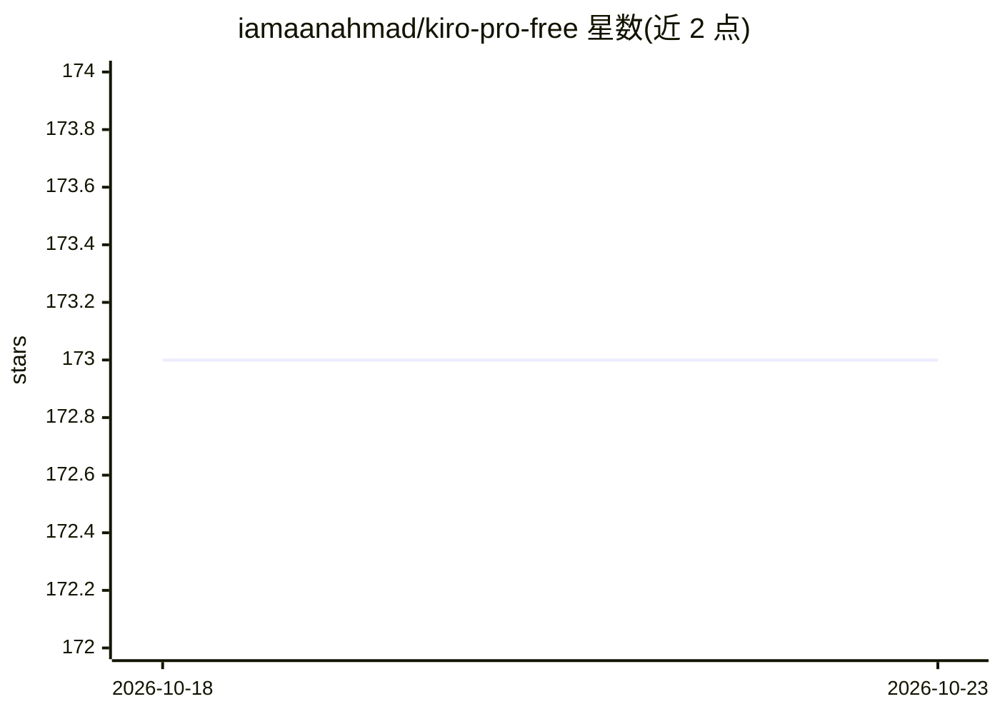

# iamaanahmad/kiro-pro-free

⭐ 173 · Python · NOASSERTION · 推送 2025-12-24 · [GitHub](https://github.com/iamaanahmad/kiro-pro-free) · [官网](https://kiro.dev/) · 个人维护

**绕过 Kiro IDE 试用与令牌限制的教育演示工具**

用 Python 编写的命令行工具，自述用于学习 IDE 绕过机制：包含机器 ID 重置、禁用自动更新、令牌限制绕过与模式发现（分析 Kiro 的 JavaScript 文件寻找可修改点）等功能，运行前自动做时间戳备份。README 声明对 Kiro 0.5.9 部分兼容：机器 ID 重置与禁用自动更新可用，令牌绕过不可用。作者明确声明该工具可能违反 Kiro IDE 服务条款、仅供教育研究用途，用户需自担风险，需 Python 3.8+ 与管理员权限。

## 筛选速览

| 维度 | 判定 | 备注 |
|---|---|---|
| AI 角色 | `ai-ecosystem` | LLM/agent 周边工具 |
| 许可风险 | `none` | NOASSERTION |
| 部署形态 | `None` |  |
| 模型依赖 | — | README 未给出锁定关系 |
| 硬件要求 | — | 无带数字的原话,不猜 |
| 安装摩擦 | `low` | 无编译、无系统依赖或容器化 |
| 成熟度 | `idea` | |

## 能力要点

- 机器 ID 重置与禁用自动更新功能在 Kiro 0.5.9 上可用
- 令牌限制绕过（宣称 200k→9M）当前不可用，附模式发现分析模式
- 修改前自动时间戳备份与文件校验
- 跨平台：Windows/macOS/Linux

## 适用场景

- 研究 IDE 软件的试用限制实现机制
- 分析 Kiro 与 Cursor 等 VSCode 分叉的代码结构差异
- 了解软件授权与服务条款相关的绕过技术原理

## 场景标签

 · 领域:开发工具/软件逆向研究

## 证据(README 行号)

> L8: **Educational tool for understanding IDE bypass mechanisms**
> L65: - 🚀 **Token Limit Bypass** - 200k → 9M tokens

## 星数曲线

2026-10-18 173 → 2026-10-23 173（+0）

---
*卡片 v1 · prompt 1.4 · 生成 2026-10-22 · 置信度 mid · 依据 README sha `e0f23e4201c8` · [字段定义](../../DATASET.md)*
