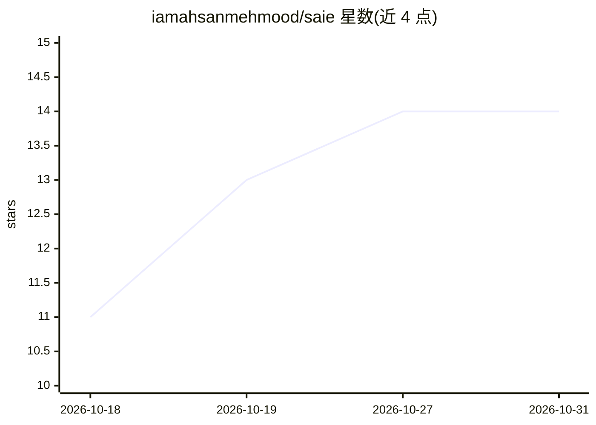

# iamahsanmehmood/saie

⭐ 14 · Python · MIT · 推送 2026-05-16 · [GitHub](https://github.com/iamahsanmehmood/saie) · [官网](https://github.com/iamahsanmehmood/saie) · 个人维护

**让 AI agent 通过 MCP 驱动 SketchUp 2025 建模的桥接工具**

由 Python MCP 服务器（saie-mcp，67+ 工具）、运行于 SketchUp 2025 内的 Ruby 插件（WebSocket 监听）和 CLI（20+ 命令）组成，采用声明式 JSON-RPC 契约而非直接 Ruby eval。Claude Desktop、Cursor、Ollama 等 MCP 客户端可让 agent 建墙、开洞、放置构件、执行碰撞检测、生成巡游动画，并通过浏览器 MJPEG 流实时查看视口。限制：需 SketchUp 2025 与 Python 3.10+，默认仅本地监听，execute_ruby 为可选高危功能可禁用。

## 筛选速览

| 维度 | 判定 | 备注 |
|---|---|---|
| AI 角色 | `ai-ecosystem` | LLM/agent 周边工具 |
| 许可风险 | `permissive` | MIT |
| 部署形态 | `library` | 以包/库形式分发 |
| 模型依赖 | local-ok | 支持本地模型 |
| 硬件要求 | — | 无带数字的原话,不猜 |
| 安装摩擦 | `low` | 无编译、无系统依赖或容器化 |
| 成熟度 | — | 结构信号不足 |

## 能力要点

- 67+ MCP 工具覆盖几何、材质、BIM 元数据、视图与报告
- Python MCP 服务器 + Ruby 插件经 WebSocket 桥接，声明式 JSON-RPC 契约
- 浏览器实时 MJPEG 视口流与 AI 快照（base64 JPEG）
- CLI 提供 20+ 命令，支持无 AI 的终端控制

## 适用场景

- 用 Claude/Cursor 等 MCP 客户端自动搭建建筑模型
- 对 SketchUp 模型运行碰撞检测并生成报告
- 离线场景用本地 Ollama 驱动建模 agent
- 解析 DXF 平面图并自动建模

## 场景标签

`Agent 框架` · 领域:Agent 开发

## 证据(README 行号)

> L14: SAIE lets **Claude, Cursor, Antigravity, Ollama, and any MCP client** drive SketchUp 2025 natively. AI agents can b
> L18: - A **Python MCP server** (`saie-mcp`) — exposes **67+ tools** to any MCP-compatible host.
> L19: - A **Ruby SketchUp plugin** — runs inside SketchUp 2025, listens on a WebSocket, executes the tool calls.

## 星数曲线

2026-10-18 11 → 2026-10-31 14（+3）

---
*卡片 v1 · prompt 1.4 · 生成 2026-10-31 · 置信度 high · 依据 README sha `7b8a5cbd4799` · [字段定义](../../DATASET.md)*
