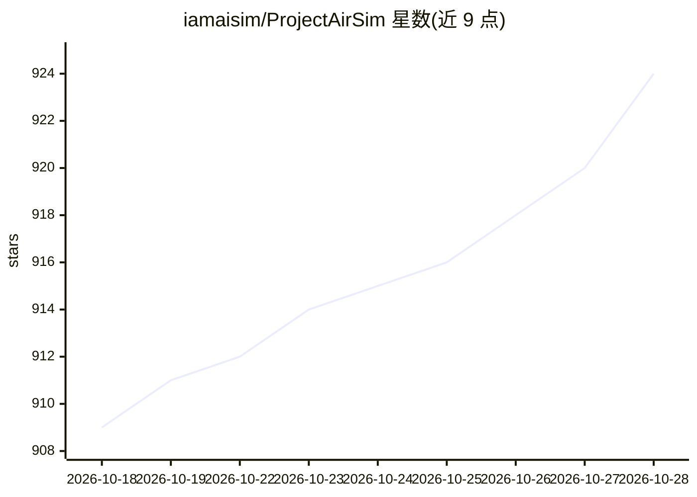

# iamaisim/ProjectAirSim

⭐ 924 · C++ · MIT · 推送 2026-10-23 · [GitHub](https://github.com/iamaisim/ProjectAirSim) · [官网](https://iamaisim.github.io/ProjectAirSim/) · 组织维护

**自主系统仿真平台：无人机等载具的构建、训练与测试**

开源、可扩展、引擎无关的自主系统仿真平台，为无人机、固定翼飞行器、无人地面载具等提供仿真核心与 Python/C++ 客户端库、ROS 2 桥。支持 Fast Physics、JSBSim、Simulink 物理模型与 PX4、ArduPilot 飞控 SITL/HITL 集成，可在不依赖 Unreal 引擎的轻量 Runtime 中运行，或结合 Unreal Engine 5 获得 3D 世界与渲染传感器。原为 Microsoft Project AirSim，Microsoft 停止该项目后由原工程团队在 IAMAI Consulting Corp. 继续维护，MIT 许可，同时提供专业服务。

## 筛选速览

| 维度 | 判定 | 备注 |
|---|---|---|
| AI 角色 | `ai-ecosystem` | LLM/agent 周边工具 |
| 许可风险 | `permissive` | MIT |
| 部署形态 | `desktop` | 安装包/桌面程序 |
| 模型依赖 | — | README 未给出锁定关系 |
| 硬件要求 | — | 无带数字的原话,不猜 |
| 安装摩擦 | `medium` | 含编译或系统依赖之一 |
| 成熟度 | — | 结构信号不足 |

## 能力要点

- 轻量引擎无关 Runtime，可不依赖 Unreal Engine 运行仿真核心与 API
- Fast Physics / JSBSim / Simulink 物理模型，含 Cessna 310 与 Skywalker X8 示例
- PX4 SITL/HITL 与 ArduPilot SITL 飞控集成，Python/C++ 客户端与 ROS 2 C++ 桥
- 支持相机、LiDAR、雷达、IMU、GPS 等可配置传感器与多载具场景

## 适用场景

- 在虚拟环境中训练与测试无人机、固定翼或地面自主系统
- 以 SITL/HITL 方式验证 PX4 或 ArduPilot 飞控
- 无渲染环境下做控制器、API 与物理层的开发调试

## 场景标签

 · 领域:机器人/自主系统仿真

## 证据(README 行号)

> L12: Project AirSim is an open-source, extensible, engine-independent simulation
> L31: Project AirSim provides a modular framework
> L65: - Connect autonomy software through Python and C++ client libraries or the ROS 2

## 星数曲线

2026-10-18 909 → 2026-10-28 924（+15）

---
*卡片 v1 · prompt 1.4 · 生成 2026-10-21 · 置信度 high · 依据 README sha `97975de90b6c` · [字段定义](../../DATASET.md)*
