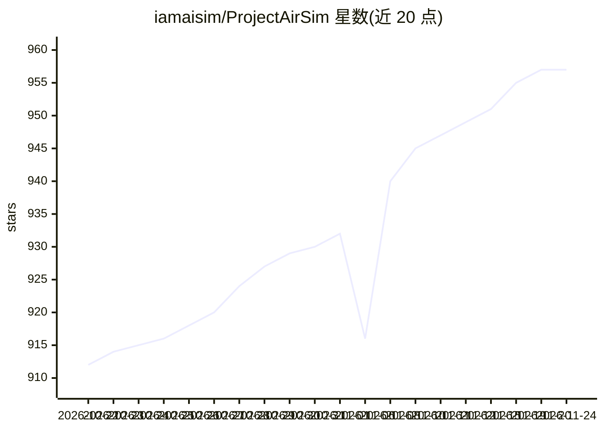

# iamaisim/ProjectAirSim

⭐ 957 · C++ · MIT · 推送 2026-11-16 · [GitHub](https://github.com/iamaisim/ProjectAirSim) · [官网](https://iamaisim.github.io/ProjectAirSim/) · 组织维护

**开源自主系统仿真平台：构建、训练、测试无人机与地面载具**

源自 Microsoft AirSim、现由 IAMAI Consulting Corp. 维护的仿真平台，覆盖多旋翼、固定翼（JSBSim）、无人地面载具等场景。核心机制是三层架构：仿真库、仿真宿主（轻量 Runtime 或 Unreal Engine 5 插件）与 Python/C++/ROS 2 客户端库；支持 PX4 SITL/HITL、ArduPilot SITL、相机/LiDAR/雷达等传感器仿真，可离屏或无渲染运行。提供预构建包下载与源码构建两条路径，MIT 许可，公司另提供专业集成服务。

## 筛选速览

| 维度 | 判定 | 备注 |
|---|---|---|
| AI 角色 | `ai-ecosystem` | LLM/agent 周边工具 |
| 许可风险 | `permissive` | MIT |
| 部署形态 | `desktop` | 安装包/桌面程序 |
| 模型依赖 | — | README 未给出锁定关系 |
| 硬件要求 | — | 无带数字的原话,不猜 |
| 安装摩擦 | `medium` | 含编译或系统依赖之一 |
| 成熟度 | — | 结构信号不足 |

## 能力要点

- 轻量 Runtime 可脱离 Unreal Engine 运行物理、控制器与 API
- 内置 Fast Physics、JSBSim、Simulink 三种物理模型可选
- 支持 PX4 SITL/HITL、ArduPilot SITL 与 ROS 2 C++ 桥接
- GPU LiDAR 360 度扫描与多载具共享仿真

## 适用场景

- 在虚拟环境中训练和验证无人机自主飞行算法
- 通过 Python 客户端控制仿真载具做感知引导飞行
- 模拟固定翼编队与 UGV 混合场景
- 在 Headless/云环境批量执行仿真验证工作流

## 场景标签

 · 领域:机器人/自主系统仿真

## 证据(README 行号)

> L13: Project AirSim is an open-source, extensible, engine-independent simulation
> L32: Project AirSim provides a modular framework
> L66: - Connect autonomy software through Python and C++ client libraries or the ROS 2

## 星数曲线

2026-10-22 912 → 2026-11-24 957（+45）

---
*卡片 v1 · prompt 1.4 · 生成 2026-11-24 · 置信度 high · 依据 README sha `3e323ee7b836` · [字段定义](../../DATASET.md)*
