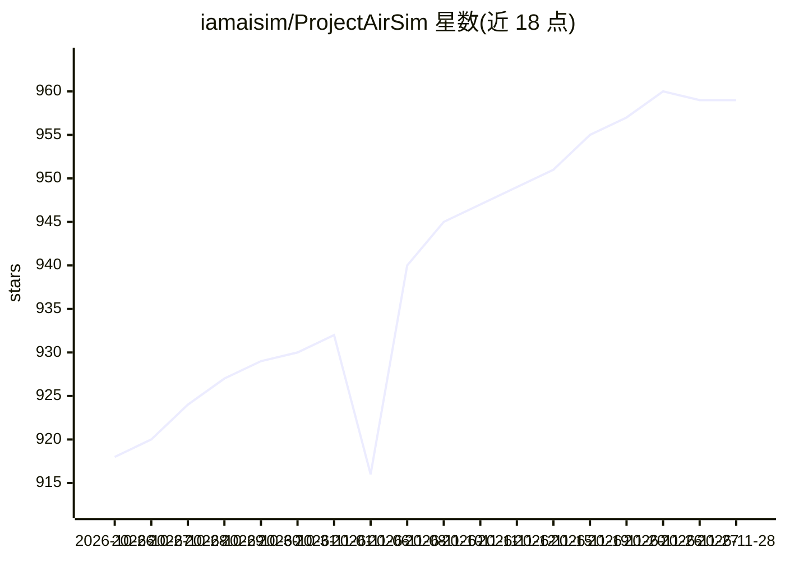

# iamaisim/ProjectAirSim

⭐ 959 · C++ · MIT · 推送 2026-11-25 · [GitHub](https://github.com/iamaisim/ProjectAirSim) · [官网](https://iamaisim.github.io/ProjectAirSim/) · 组织维护

**面向无人机与自主系统的开源仿真平台**

由 IAMAI 维护的开源可扩展仿真平台，源自 Microsoft AirSim 项目，用于构建、训练与测试无人机、固定翼、UGV 等自主系统。仿真核心与 API 可脱离 Unreal Engine 在轻量 Runtime 中运行，需要 3D 世界与渲染传感器时使用 UE5 插件。支持 C++ Fast Physics、JSBSim、Simulink 物理，兼容 PX4 SITL/HITL、ArduPilot SITL，传感器覆盖相机、LiDAR、雷达、IMU 等，通过 Python/C++ 客户端或 ROS 2 桥接入。源码构建需 Unreal Engine、CMake 与 C++17。

## 筛选速览

| 维度 | 判定 | 备注 |
|---|---|---|
| AI 角色 | `ai-ecosystem` | LLM/agent 周边工具 |
| 许可风险 | `permissive` | MIT |
| 部署形态 | `desktop` | 安装包/桌面程序 |
| 模型依赖 | — | README 未给出锁定关系 |
| 硬件要求 | — | 无带数字的原话,不猜 |
| 安装摩擦 | `medium` | 含编译或系统依赖之一 |
| 成熟度 | — | 结构信号不足 |

## 能力要点

- 仿真核心可在无 Unreal Engine 的轻量 Runtime 中运行
- 支持 PX4 SITL/HITL 与 ArduPilot SITL 飞控工作流
- 支持相机、LiDAR、雷达、IMU、GPS 等可配置传感器
- 提供 Python/C++ 客户端库与 ROS 2 C++ 桥接

## 适用场景

- 在虚拟环境中仿真与测试无人机自主算法
- 做多机/机群编队仿真验证
- 构建 PX4/ArduPilot 软件在环或硬件在环工作流
- 无渲染环境下开发控制器、API 与物理逻辑

## 场景标签

 · 领域:机器人/自主系统仿真

## 证据(README 行号)

> L13: Project AirSim is an open-source, extensible, engine-independent simulation
> L66: - Connect autonomy software through Python and C++ client libraries or the ROS 2
> L138: 1. **Simulation libraries** provide the base infrastructure for defining robot

## 星数曲线

2026-10-26 918 → 2026-11-28 959（+41）

---
*卡片 v1 · prompt 1.4 · 生成 2026-11-26 · 置信度 high · 依据 README sha `06d400507711` · [字段定义](../../DATASET.md)*
