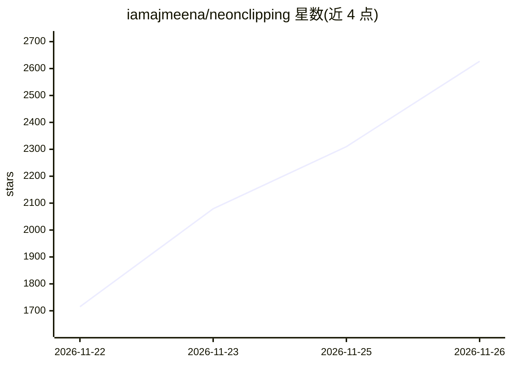

# iamajmeena/neonclipping

⭐ 2,627 · Python · AGPL-3.0 · 推送 2026-11-24 · [GitHub](https://github.com/iamajmeena/neonclipping) · 个人维护

**本地运行的开源视频切片引擎：粘贴链接生成带字幕竖版短视频**

NeonClipping 把 YouTube/Twitch/Kick 长视频或本地 MP4 转成 9:16 带字幕切片并生成标题与 hook，全程本地运行、无需账号与上传。快速模式只下载音频、优先复用 YouTube 字幕做转写、按响度跳变等信号评分，再用 Ollama 本地 LLM 打分写标题，最后仅下载选中片段渲染 1080x1920；深度模式加入光流运动信号。提供 11 种游戏画面布局、52 种字幕语言、Hinglish 转写、偏好评分反馈学习。安装依赖 Python 3.10–3.13 与 FFmpeg，Mac 安装脚本作者自述未经真机验证。

## 筛选速览

| 维度 | 判定 | 备注 |
|---|---|---|
| AI 角色 | `ai-native` | 本体是模型或模型工具 |
| 许可风险 | `permissive` | AGPL-3.0 |
| 部署形态 | `desktop` | 安装包/桌面程序 |
| 模型依赖 | local-ok | 支持本地模型 |
| 硬件要求 | — | 无带数字的原话,不猜 |
| 安装摩擦 | `medium` | 含编译或系统依赖之一 |
| 成熟度 | — | 结构信号不足 |

## 能力要点

- 音频优先流程：85 分钟视频仅下载 79 MB 音频，评分后只下载选中片段
- 优先复用 YouTube 逐词字幕，无字幕来源回退本地 Whisper 模型
- 本地 LLM（Ollama）生成标题与 hook，五星级反馈可更新本地排序权重
- 11 种游戏画面布局自动/手动画框，1080p 默认导出（NVENC/VideoToolbox/x264）

## 适用场景

- 把游戏直播录像切成带字幕的竖版短视频
- 给长视频批量生成片段标题与开场引导语
- 离线环境处理本地 MP4 并导出 SRT/WebVTT 字幕

## 场景标签

`视频生成` · 领域:内容生成

## 证据(README 行号)

> L5: NeonClipping turns long YouTube / Twitch / Kick videos (or your own MP4) into vertical, captioned clips with a title
> L45: 4. Take the best moments, read each one's transcript with a local LLM (Ollama) and let it score the moment, write a
> L125: Open <http://127.0.0.1:8770>, paste a link, press **⚡ Make clips**.

## 星数曲线

2026-11-22 1,715 → 2026-11-26 2,627（+912）

---
*卡片 v1 · prompt 1.4 · 生成 2026-11-24 · 置信度 mid · 依据 README sha `8256b862ce96` · [字段定义](../../DATASET.md)*
