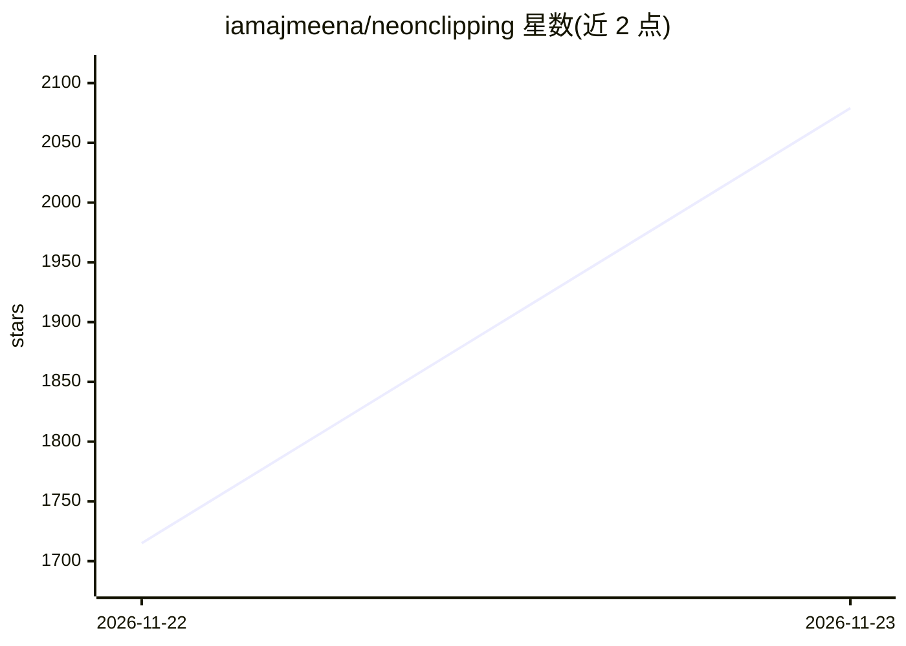

# iamajmeena/neonclipping

⭐ 2,079 · Python · MIT · 推送 2026-11-21 · [GitHub](https://github.com/iamajmeena/neonclipping) · 个人维护

**本地运行的视频转 9:16 字幕剪辑工具，粘贴链接生成短视频片段**

NeonClipping 将 YouTube/Twitch/Kick 长视频或本地 MP4 转为带标题、hook 和烧录字幕的竖屏片段，全部在本机运行、不上传。快速模式仅下载音频并复用 YouTube 字幕转录，用响度跳变、2-4 kHz 能量、光流运动等信号打分，再用本地 LLM（Ollama）生成标题与评分；深度模式下载整片并加入光流与切镜密度信号。支持 11 种 facecam 布局、52 种字幕语言、片段重剪与本地偏好权重适应。依赖 Python 3.10-3.13 与 FFmpeg。

## 筛选速览

| 维度 | 判定 | 备注 |
|---|---|---|
| AI 角色 | `ai-native` | 本体是模型或模型工具 |
| 许可风险 | `permissive` | MIT |
| 部署形态 | `desktop` | 安装包/桌面程序 |
| 模型依赖 | local-ok | 支持本地模型 |
| 硬件要求 | — | 无带数字的原话,不猜 |
| 安装摩擦 | `medium` | 含编译或系统依赖之一 |
| 成熟度 | — | 结构信号不足 |

## 能力要点

- 快速模式只下载音频与选定片段，85 分钟视频 97 秒出 3 个片段（自报测量）
- 本地 LLM（Ollama）生成标题、hook 与时刻评分，无需 API 密钥
- 11 种 facecam/游戏画面布局与 5 种字幕风格，SRT/WebVTT 导出
- 五星级评分数据留存本地，可调整本地排序权重

## 适用场景

- 把长直播录像批量切成带字幕的短视频
- 游戏主播给 facecam+游戏画面做竖屏重排版式
- 断网/无 API 账号环境下本地剪辑
- 为已生成片段重新调整起止点与字幕

## 场景标签

`图像视频处理` · 领域:感知与多模态

## 证据(README 行号)

> L5: NeonClipping turns long YouTube / Twitch / Kick videos (or your own MP4) into vertical, captioned clips with a title
> L45: 4. Take the best moments, read each one's transcript with a local LLM (Ollama) and let it score the moment, write a

## 星数曲线

2026-11-22 1,715 → 2026-11-23 2,079（+364）

---
*卡片 v1 · prompt 1.4 · 生成 2026-11-22 · 置信度 mid · 依据 README sha `b67a029fa147` · [字段定义](../../DATASET.md)*
