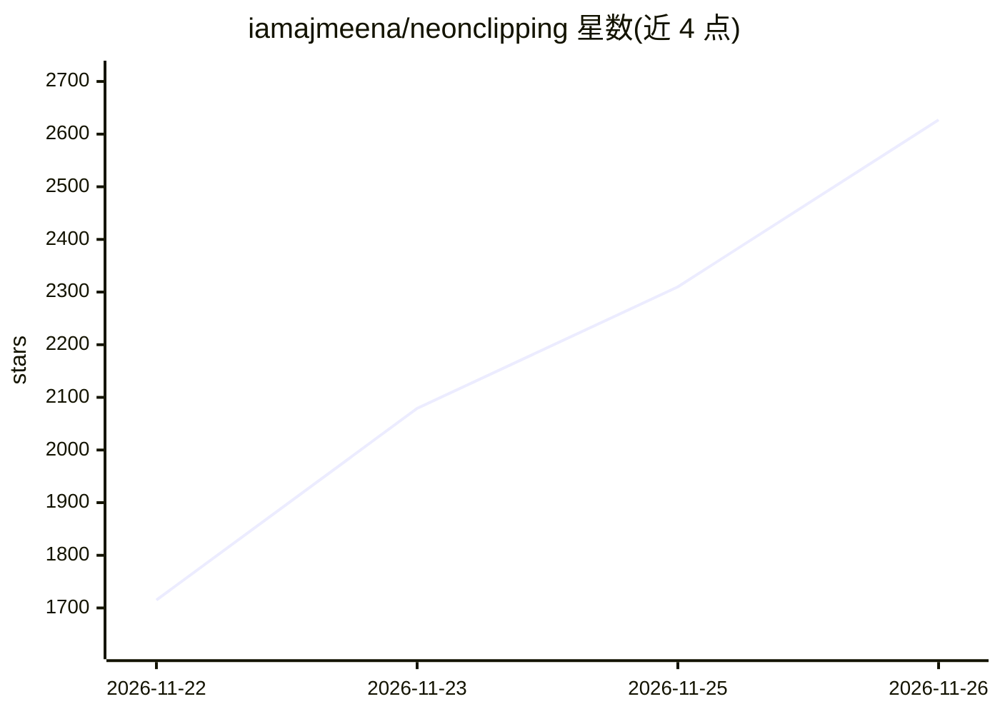

# iamajmeena/neonclipping

⭐ 2,627 · Python · AGPL-3.0 · 推送 2026-11-24 · [GitHub](https://github.com/iamajmeena/neonclipping) · 个人维护

**把长视频本地转成带字幕竖屏短片段的剪辑引擎**

本地运行的开源剪辑工具：粘贴 YouTube/Twitch/Kick 链接或本地 MP4，生成 9:16 带字幕片段并附标题与 hook。Fast 模式仅下载音频，优先复用 YouTube 自带逐词字幕，无字幕时回退本地 Whisper；按响度跳变、音调能量、光流运动等信号打分，用 Ollama 本地 LLM 对候选片段写标题评分；Deep 模式下载全片并加入光流与镜头切换密度。支持 11 种面cam布局、5 种字幕风格、52 种语言、评分反馈自适应排序。Windows 提供 .bat 安装，Mac/Linux 提供 install.sh 与源码运行。

## 筛选速览

| 维度 | 判定 | 备注 |
|---|---|---|
| AI 角色 | `ai-native` | 本体是模型或模型工具 |
| 许可风险 | `dual` | AGPL-3.0 |
| 部署形态 | `desktop` | 安装包/桌面程序 |
| 模型依赖 | local-ok | 支持本地模型 |
| 硬件要求 | — | 无带数字的原话,不猜 |
| 安装摩擦 | `medium` | 含编译或系统依赖之一 |
| 成熟度 | — | 结构信号不足 |

## 能力要点

- 音频优先流程：85 分钟视频仅下载 79MB 音频，YouTube 逐词字幕免模型
- 本地 Ollama LLM 为片段生成标题、hook 与评分，无 API 成本
- 11 种面cam/游戏画面布局与 5 种字幕样式，支持 Hinglish 字幕
- 五星级评分本地反馈，权重可自适应调整偏好排序

## 适用场景

- 把游戏直播录像切成分段竖屏片段发短视频
- 无需上传云端，本地批量处理自己的 VOD
- 给片段加多语言烧录字幕并导出 SRT/WebVTT

## 场景标签

`视频生成` · 领域:内容生成

## 证据(README 行号)

> L5: NeonClipping turns long YouTube / Twitch / Kick videos (or your own MP4) into vertical, captioned clips with a title
> L43: 2. Take the transcript for free from YouTube's own captions (word-timed). No speech model needed. For other sources
> L114: Requirements: Python 3.10 to 3.13 (the newest Python often has no wheels for the speech/vision packages yet; the M

## 星数曲线

2026-11-22 1,715 → 2026-11-26 2,627（+912）

---
*卡片 v1 · prompt 1.4 · 生成 2026-11-26 · 置信度 mid · 依据 README sha `c05fd3bebb62` · [字段定义](../../DATASET.md)*
