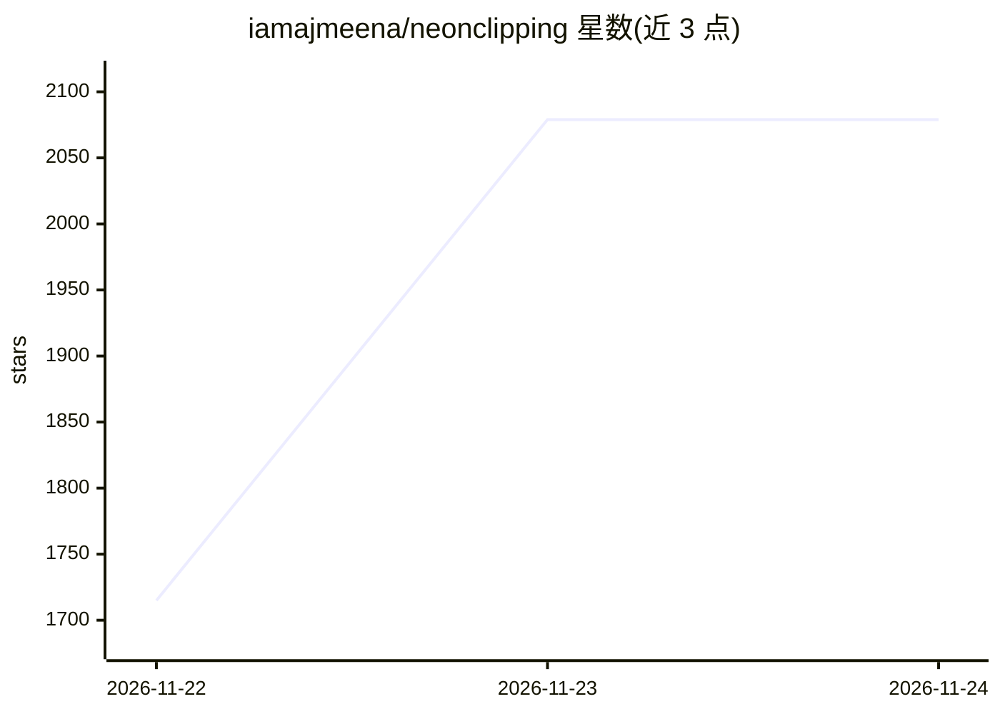

# iamajmeena/neonclipping

⭐ 2,079 · Python · MIT · 推送 2026-11-21 · [GitHub](https://github.com/iamajmeena/neonclipping) · 个人维护

**本地运行的视频切片引擎：粘贴链接生成带字幕的竖屏短片**

NeonClipping 将 YouTube/Twitch/Kick 长视频或本地 MP4 转为带字幕、标题与 hook 的 9:16 竖屏切片，全部在本机运行，不上传、无账号。机制：默认 Fast 模式只下载音频，优先复用 YouTube 自带逐词字幕，用响度跳变/高频能量/光流运动等信号打分候选片段，再用本地 LLM（Ollama）评分并写标题；Deep 模式下载全片加入光流与切镜密度。依赖 Python 3.10–3.13 与 FFmpeg，支持 NVIDIA NVENC/VideoToolbox/x264 编码。提供星级反馈训练本地偏好排序权重。

## 筛选速览

| 维度 | 判定 | 备注 |
|---|---|---|
| AI 角色 | `ai-native` | 本体是模型或模型工具 |
| 许可风险 | `permissive` | MIT |
| 部署形态 | `desktop` | 安装包/桌面程序 |
| 模型依赖 | local-ok | 支持本地模型 |
| 硬件要求 | — | 无带数字的原话,不猜 |
| 安装摩擦 | `medium` | 含编译或系统依赖之一 |
| 成熟度 | — | 结构信号不足 |

## 能力要点

- 音频优先管线：85 分钟流媒体 97 秒完成切片，零 API 成本
- Fast/Deep 双模式：Fast 只下载选定片段，24 小时视频无需全量下载
- 本地 LLM（Ollama）评分、写标题与 hook，评级数据留在本机
- 11 种直播构图布局与 5 种字幕样式，52 种字幕语言

## 适用场景

- 把直播录像切成竖屏短片发 Shorts/Reels
- 游戏主播自动定位 facecam 并生成带字幕切片
- 离线/无 API 环境下本地批量切片

## 场景标签

`语音识别` `图像视频处理` · 领域:感知与多模态

## 证据(README 行号)

> L5: NeonClipping turns long YouTube / Twitch / Kick videos (or your own MP4) into vertical, captioned clips with a title
> L43: 2. Take the transcript for free from YouTube's own captions (word-timed). No speech model needed. For other sources
> L45: 4. Take the best moments, read each one's transcript with a local LLM (Ollama) and let it score the moment, write a

## 星数曲线

2026-11-22 1,715 → 2026-11-24 2,079（+364）

---
*卡片 v1 · prompt 1.4 · 生成 2026-11-23 · 置信度 mid · 依据 README sha `99f5e3367cb5` · [字段定义](../../DATASET.md)*
