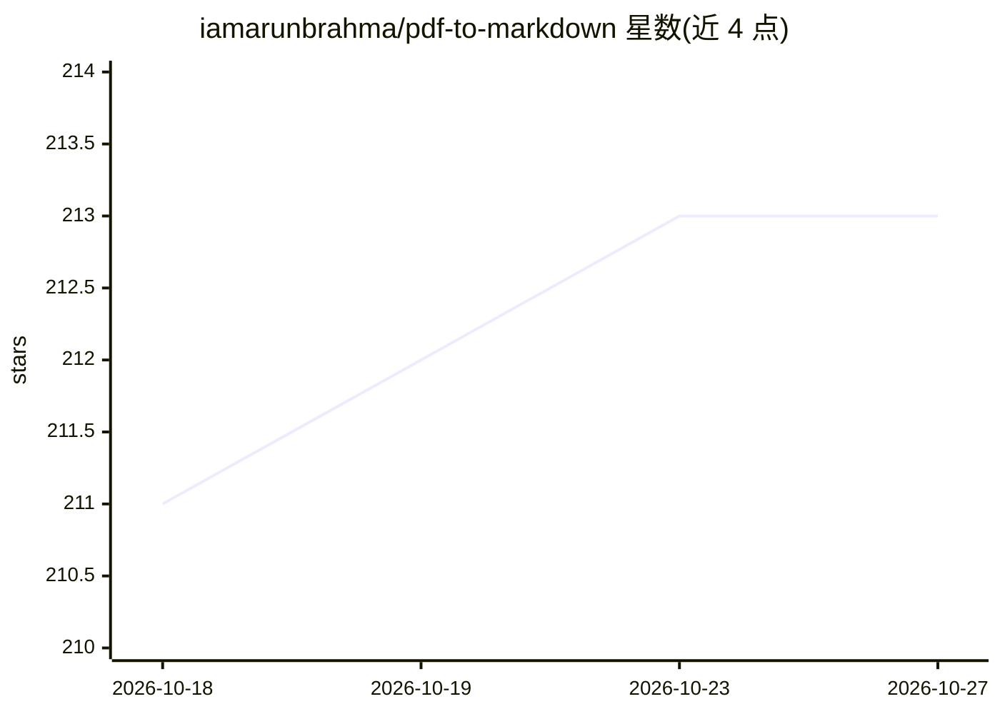

# iamarunbrahma/pdf-to-markdown

⭐ 213 · Python · MIT · 推送 2026-09-14 · [GitHub](https://github.com/iamarunbrahma/pdf-to-markdown) · 个人维护

**纯 Python 的 PDF 转 Markdown 结构化提取工具**

基于 pdfplumber/pdfminer.six 的 PDF 转 Markdown 工具，提取标题、列表、表格、代码块、数学公式（启发式转 LaTeX）、多栏阅读顺序、脚注与图片等结构，输出 GFM 格式 .md 文件。核心依赖仅 MIT 许可库，不含 PyMuPDF 与重型 ML/OCR 栈；数学公式高精度识别通过可选 pix2tex 扩展提供，进度条由可选 tqdm 扩展提供。无 OCR 能力，扫描件仅能提取嵌入图片。通过 uv 安装，支持 CLI 与 Python 库两种用法。

## 筛选速览

| 维度 | 判定 | 备注 |
|---|---|---|
| AI 角色 | `ai-enhanced` | 去掉 AI 部分产品仍成立 |
| 许可风险 | `permissive` | MIT |
| 部署形态 | `None` |  |
| 模型依赖 | — | README 未给出锁定关系 |
| 硬件要求 | — | 无带数字的原话,不猜 |
| 安装摩擦 | `low` | 无编译、无系统依赖或容器化 |
| 成熟度 | — | 结构信号不足 |

## 能力要点

- 基于 MIT 许可的 pdfplumber/pdfminer.six，依赖树无 AGPL 与重型 ML/OCR
- 提取标题/列表/表格/代码/数学转 LaTeX/多栏布局/脚注/CJK 文本
- 可选 pix2tex 扩展提升公式识别精度，核心安装保持精简
- 可作 CLI 或 Python 库使用，行为经 config.yaml 调节

## 适用场景

- 把论文或报告 PDF 转成 Markdown 供知识库/RAG 流水线使用
- 批量转换含表格与公式的技术文档为结构化文本
- 无需 ML 环境的轻量 PDF 文本结构化提取

## 场景标签

`文档解析` · 领域:知识与检索

## 证据(README 行号)

> L14: AGPL (`PyMuPDF`) and no heavy ML/OCR stack anywhere in the dependency tree.
> L46: extra (`pix2tex`, which pulls in BSD `torch` - kept out of the core so the

## 星数曲线

2026-10-18 211 → 2026-10-27 213（+2）

---
*卡片 v1 · prompt 1.4 · 生成 2026-10-22 · 置信度 mid · 依据 README sha `9fcb4b048307` · [字段定义](../../DATASET.md)*
