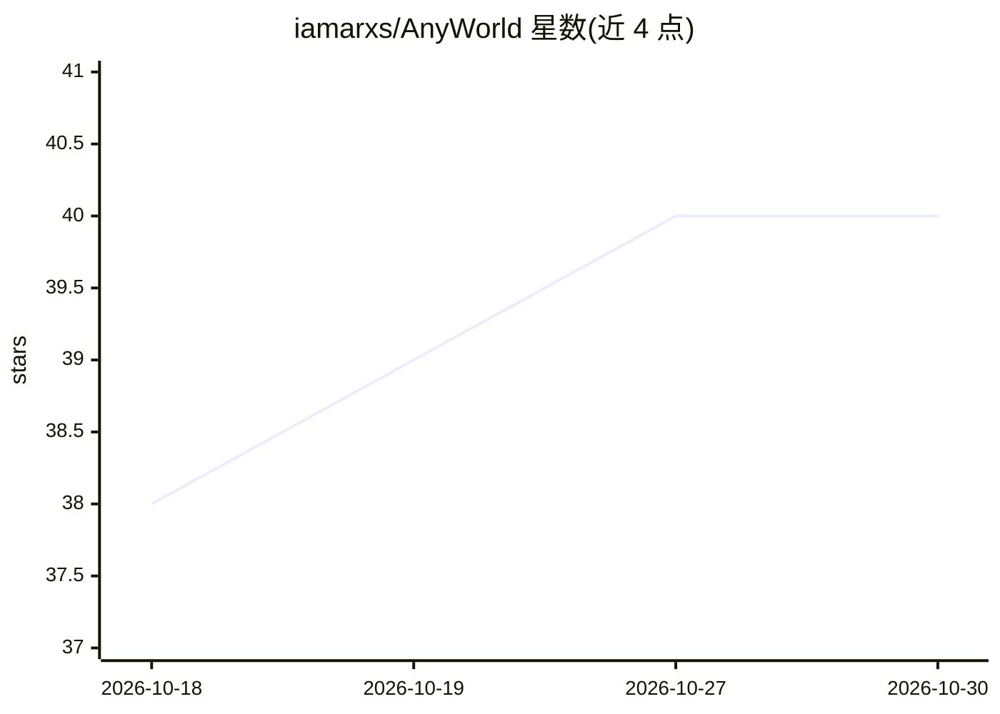

# iamarxs/AnyWorld

⭐ 40 · Python · MIT · 推送 2026-10-29 · [GitHub](https://github.com/iamarxs/AnyWorld) · 个人维护

**多人在线文字冒险游戏：AI 担任地下城主串联剧情**

基于 Python/FastAPI 的多人浏览器文字冒险游戏：主持人描述场景后，玩家用自己的语言轮流描述行动，AI 作为地下城主生成开场、逐轮叙述结果并推进剧情。支持可选的私有剧情引导、百分比/触发式随机事件规则、场景保存/加载（localStorage）、公共历史浏览与 JSONL 导出。AI 后端可选本地 llama.cpp（NVIDIA GPU）或 OpenAI；本地后端目前仅英文叙述。提供 Docker compose 快速启动（含临时 Cloudflare tunnel）与 Python 直跑两种部署方式，附本地模型指令遵循基准测试脚本。

## 筛选速览

| 维度 | 判定 | 备注 |
|---|---|---|
| AI 角色 | `ai-native` | 本体是模型或模型工具 |
| 许可风险 | `permissive` | MIT |
| 部署形态 | `self-host` | docker 或自建部署 |
| 模型依赖 | — | README 未给出锁定关系 |
| 硬件要求 | — | 无带数字的原话,不猜 |
| 安装摩擦 | `low` | 无编译、无系统依赖或容器化 |
| 成熟度 | — | 结构信号不足 |

## 能力要点

- AI 作为地下城主逐轮生成剧情叙述
- 私有 DM 引导与百分比/触发式随机事件规则
- 支持本地 llama.cpp 或 OpenAI 后端，Docker compose 一键启动
- 自带本地模型指令遵循基准测试脚本与 token 用量显示

## 适用场景

- 和朋友们联机玩由 AI 主持的文字 RPG 冒险
- 测试本地模型担任 DM 的指令遵循与叙事能力
- 通过保存的场景重复或分享冒险设定

## 场景标签

 · 领域:游戏/AI 娱乐

## 证据(README 行号)

> L5: A multiplayer text adventure where you never have to roll dice or keep score — just write what your
> L6: character does. One player (the host) describes the scenario, then everyone takes turns acting in
> L7: their own words while an AI weaves every choice into a story that keeps unfolding.

## 星数曲线

2026-10-18 38 → 2026-10-30 40（+2）

---
*卡片 v1 · prompt 1.4 · 生成 2026-10-25 · 置信度 high · 依据 README sha `c69ab27339b7` · [字段定义](../../DATASET.md)*
