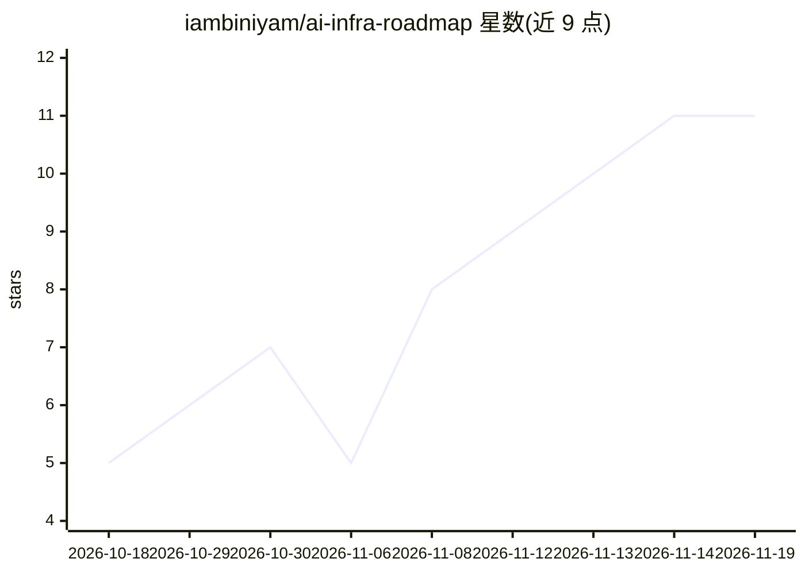

# iambiniyam/ai-infra-roadmap

⭐ 11 · Python · MIT · 推送 2026-11-16 · [GitHub](https://github.com/iambiniyam/ai-infra-roadmap) · 个人维护

**AI 基础设施学习路线图：9 层栈地图与 6 阶段进阶**

免费开源的 AI 基础设施学习路线图仓库：将 AI infra 拆为硬件到可观测性的 9 层地图，配 6 个阶段（含 RL 后训练半步）及退出标准；STACK.md 收录 220+ 开源项目（含 star 数与许可证，机器人每周刷新），PROJECTS.md 提供 17 个带验收标准的可动手项目，另有硬件、术语表、速查表与职业章节。MIT 许可，纯文档形态，面向从后端工程师到 SRE、学生等不同背景读者并给出入口建议。

## 筛选速览

| 维度 | 判定 | 备注 |
|---|---|---|
| AI 角色 | `ai-knowledge` | 知识聚合/清单类 |
| 许可风险 | `permissive` | MIT |
| 部署形态 | `None` |  |
| 模型依赖 | — | README 未给出锁定关系 |
| 硬件要求 | — | 无带数字的原话,不猜 |
| 安装摩擦 | `medium` | 含编译或系统依赖之一 |
| 成熟度 | — | 结构信号不足 |

## 能力要点

- 9 层栈地图 + 6 阶段路线图，每阶段带退出标准
- 220+ 经过筛选的开源项目，star 数每周自动刷新
- 17 个带验收标准的可动手构建项目
- 速查表涵盖推理数学、训练并行、集群运维、RL 后训练等公式

## 适用场景

- 后端工程师想系统性转入 AI 基础设施方向
- SRE 接手 GPU 集群需要补齐调度与运维知识
- 为学 infra 寻找带验收标准的练手项目
- 选型时查阅各层工具的社区默认选项

## 场景标签

`教程课程` `精选清单` · 领域:学习与行业

## 证据(README 行号)

> L14: AI infrastructure is the discipline of making models **train faster, serve cheaper, and stay up**: GPUs, kernels, d
> L24: 3. **A curated stack** of 220+ open-source projects with live star counts and licenses, so you pick the boring, cor
> L135: |**STACK.md**|Over 200 projects across all 9 layers, with stars, license, and when to use each|You're choosing a t

## 星数曲线

2026-10-18 5 → 2026-11-19 11（+6）

---
*卡片 v1 · prompt 1.4 · 生成 2026-11-18 · 置信度 high · 依据 README sha `a3bd4b3e1e0a` · [字段定义](../../DATASET.md)*
