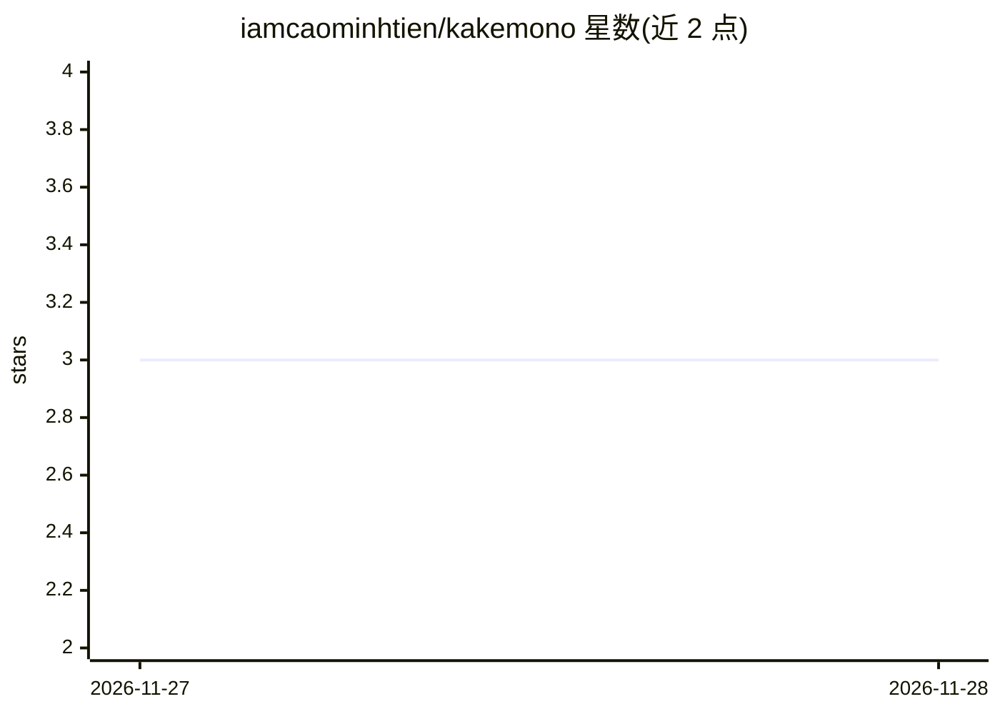

# iamcaominhtien/kakemono

⭐ 3 · Rust · MIT · 推送 2026-11-27 · [GitHub](https://github.com/iamcaominhtien/kakemono) · 个人维护

**Rust 文档转换库：PDF/Word/EPUB 转 HTML/Markdown 等格式**

kakemono 是一个 Rust 编写的文档转换器与库，从 PDF、Word（.docx/.doc）、EPUB 及 arXiv 论文中提取阅读顺序与结构（标题、表格、公式、图片），输出 HTML、DOCX、Markdown、LaTeX、Typst、EPUB、可编辑 JSON 及用于检索的 JSONL 分块。CLI 无需 Python、Poppler 或 MuPDF，PDF 处理基于 hayro。支持导出可编辑 JSON 后回填生成新文档；不支持扫描版与加密 PDF。提供预编译二进制、cargo 安装与 Python 绑定。

## 筛选速览

| 维度 | 判定 | 备注 |
|---|---|---|
| AI 角色 | `ai-enhanced` | 去掉 AI 部分产品仍成立 |
| 许可风险 | `permissive` | MIT |
| 部署形态 | `library` | 以包/库形式分发 |
| 模型依赖 | — | README 未给出锁定关系 |
| 硬件要求 | — | 无带数字的原话,不猜 |
| 安装摩擦 | `medium` | 含编译或系统依赖之一 |
| 成熟度 | — | 结构信号不足 |

## 能力要点

- 从 PDF/Word/EPUB/arXiv 提取结构并转换为 HTML、Markdown、LaTeX、Typst、EPUB、JSON 等 8 类格式
- 输出面向检索的 JSONL 分块（可指定 chunk-tokens）
- HTML 提供四种布局模式（friendly/medium/hard-95/hard）
- 支持导出可编辑 JSON、修改文本后回填生成新输出

## 适用场景

- 把 arXiv 论文转成 Markdown 便于阅读与存档
- 为检索/RAG 流程从 PDF 生成 JSONL 文本分块
- 将 Word 报告排版输出为 PDF
- 批量把电子书 EPUB 转成其他格式

## 场景标签

`文档解析` · 领域:知识与检索

## 证据(README 行号)

> L14: kakemono is a Rust document converter and library. It extracts reading order and structure from PDFs, Word files an
> L50: kakemono convert paper.pdf -o paper.jsonl --chunk-tokens 512

## 星数曲线

2026-11-27 3 → 2026-11-28 3（+0）

---
*卡片 v1 · prompt 1.4 · 生成 2026-11-27 · 置信度 high · 依据 README sha `122b806ccf4d` · [字段定义](../../DATASET.md)*
